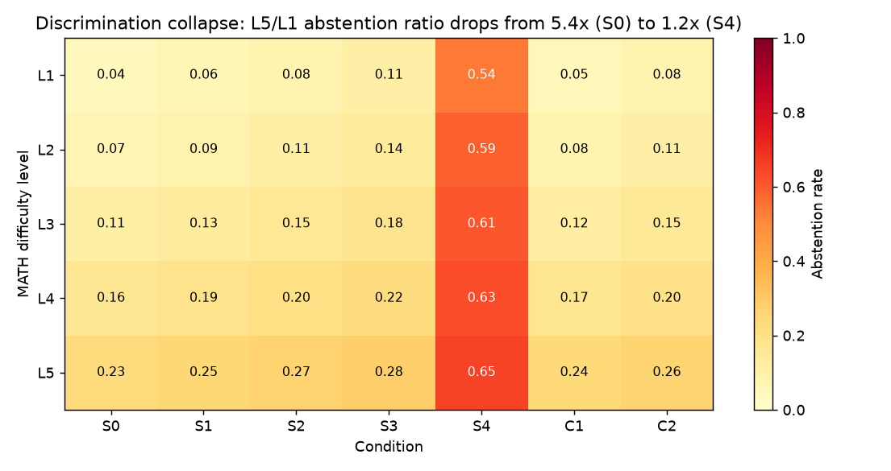

# Project FEAR

### The Fear of Being Wrong: How Punishment-Dominant Asymmetric Rewards Shape Confidence Calibration, Selective Abstention, and Judge Capability in Language Models

A research project (FEAR = Fear-Enhanced Asymmetric Rewards) investigating whether
asymmetric reinforcement-learning rewards, where the penalty for a wrong answer is much
larger than the reward for a correct one, make language models better calibrated and more
willing to abstain when they are uncertain.

**Period:** March 2026 to June 2026
**Status:** Trained and evaluated at 1.5B and 3B scale. Stopped before larger-scale (7B and full multi-seed) confirmation for lack of compute, not because the questions were closed. See [Limitations](#limitations-why-this-stopped).

---

## TL;DR

We built a complete GRPO training and calibration-evaluation pipeline on Qwen 2.5 1.5B and
3B base models, then swept seven reward conditions across six math and general-reasoning
benchmarks. The empirical answer to "does asymmetry help calibration" was **no**, and the
explanation became the contribution.

Under GRPO with within-group z-score advantage normalization, the entire reward design
(reward for correct, penalty for wrong, reward for abstaining) collapses to a single
effective degree of freedom: an abstention-threshold dial. Asymmetry shifts how often the
model stays silent, but it does not improve per-question calibration or
accuracy-when-answering. We call this **Finding O**. It gives a mechanistic reason for the
field's convergence on simple positive-only rewards, a point no published GRPO paper had
stated, and it is backed by a 3B-scale confirmation, an ablation that removes the
normalization, and a cross-task transfer test.

---

## The research question

Does training with asymmetric RLVR rewards (penalty for wrong much greater than reward for
correct) produce models that are better calibrated, more selectively abstinent on uncertain
queries, and better at detecting reasoning errors than models trained with standard
symmetric rewards?

The design idea: set `R_correct = +alpha`, `R_incorrect = -beta`, `R_abstain = 0`, with
alpha much smaller than beta. A utility-maximizing model should then answer only when its
confidence exceeds the threshold `beta / (alpha + beta)`, so the alpha-to-beta ratio is a
direct confidence-threshold knob. Abstention is never given an explicit "I don't know"
token. The model earns the abstain reward of 0 naturally whenever the verifier cannot
extract a boxed answer, so it has to discover silence as a strategy.

This builds on Zhu et al. (arXiv:2506.01347) and SimpleRL-Zoo, which suggested asymmetric or
abstention-aware rewards help. We tested that hypothesis rigorously at small scale and found
the mechanism that limits it.

---

## Key contribution: Finding O

**Finding O.** Under GRPO with within-group z-score normalization, every two-outcome rollout
group produces identical advantages regardless of alpha and beta (an affine invariance of
the z-score). The seven-condition sweep is therefore really a one-dimensional
abstention-threshold dial, not seven independent experiments. Per-question discrimination
cannot improve, because the gradient carries no per-question confidence signal. Only a
global threshold can shift.

Three results harden this from a derivation into a defensible empirical claim:

1. **Equivalence (C2 is equivalent to S2).** Explicit abstention (a positive reward for
   silence) and implicit abstention (avoiding the wrong-answer penalty) reach the same
   policy when matched on the implied threshold, confirmed on every corrected metric.
2. **3B scale-up.** Per-attempt accuracy across the frontier conditions matched to within
   about 0.004; only the abstention rate moved. The 1.5B mechanism reappears unchanged at 3B.
3. **The normalization is what stabilizes it.** Removing the z-score normalization
   (`zhu_signed`) lets the raw reward magnitude reach behavior again: a high-penalty
   condition abstained roughly three times as often, but toward over-abstention and
   degradation. So GRPO's normalization is not just what hides asymmetry, it is what keeps
   asymmetric training stable.

A cross-task probe closes the loop: the abstention threshold learned on math generation
transfers to PRM800K step-judging, while judging quality does not, confirming that the
reward acts on the abstain axis rather than on competence.

---

## Headline results

Full numbers, tables, and the 23-finding catalogue are in [RESULTS.md](RESULTS.md) and the
end-to-end [project report](docs/PROJECT_REPORT.md).

- **The main answer is no.** Asymmetric rewards did not improve calibration or
  accuracy-when-answering. They only moved the operating point, that is, how often the model
  abstains.
- **The sweep is a 1-D dial.** On the single-shot frontier, attempt rate drops monotonically
  from S0 to S4 while accuracy-on-attempted stays flat, so punishment does not
  preferentially remove wrong answers.
- **S4 (pure penalty) collapses** to near-total abstention, exactly the predicted degenerate
  corner.
- **No fear condition beats its non-fear counterpart** on the risk-coverage frontier
  (matched-compute AURC).
- **A single forward-pass probe is the cheap win.** A linear probe on last-token hidden
  states is a selective-prediction signal worth roughly three self-consistency samples
  (compute-crossover K* around 3.1 on MATH and 3.7 on GSM8K), and it transfers within the
  reasoning family. On TruthfulQA the in-domain probe reaches AUROC 0.990, a striking gap
  between what the model knows internally and what it says.




---

## Method

### The reward signal

Every response receives one of three scalar rewards:

- correct boxed answer: `+alpha`
- incorrect boxed answer: `-beta`
- no boxed answer at all (silence): `+abstain`

An expected-value-rational agent attempts only when its success probability exceeds the
implied threshold `(beta + abstain) / (alpha + beta)`. The seven conditions tile that
threshold from 0.50 to 1.00 through two mechanisms.

| Condition | alpha | beta | abstain | EV threshold | Description |
|---|---|---|---|---|---|
| S0 | 1.0 | 1.0 | 0.0 | 0.50 | Symmetric baseline (standard RLVR) |
| S1 | 1.0 | 2.0 | 0.0 | 0.67 | Mild asymmetry |
| S2 | 0.5 | 2.0 | 0.0 | 0.80 | Moderate asymmetry |
| S3 | 0.1 | 1.0 | 0.0 | 0.91 | Matches Zhu et al. lambda = 0.1 |
| S4 | 0.0 | 1.0 | 0.0 | 1.00 | Pure negative-sample reinforcement (degenerate) |
| C1 | 1.0 | 1.0 | 0.2 | 0.60 | Symmetric plus mild explicit abstain reward |
| C2 | 1.0 | 1.0 | 0.5 | 0.75 | Symmetric plus strong explicit abstain reward (matched to S2) |

S0 to S4 form the implicit-abstention sweep (the FEAR core hypothesis). C1 and C2 form the
explicit-abstention parallel. The C2-versus-S2 head-to-head at a matched threshold near 0.80
is the novel mechanism comparison.

### Pipeline

- Trained all seven conditions for 1500 GRPO steps each at 1.5B, scaled the frontier
  conditions to 3B, and pushed every adapter to the Hugging Face Hub.
- Evaluated with K=16 and K=32 vLLM rollouts per problem across MATH, GSM8K, AIME 2024, AIME
  2025, MMLU-STEM, and TruthfulQA-MC, reporting accuracy, abstention rate, calibration error,
  and selective-prediction curves.
- Generated 6000 reference traces (qwen3:30b via Ollama) and ran a cross-task judging eval
  that uses the trained adapters as PRM800K step-correctness judges.
- Ran advantage-normalization ablations (z_score, global_mean, zhu_signed) and an SFT "I
  don't know" warm-start to probe the explicit abstention channel.

A trainer-side patch into TRL 0.15's `_prepare_inputs` injects the custom advantage norms,
the confidence-weight rescale, and a standard-deviation-floor guard that zeros advantages
when an all-abstain group collapses the intra-group variance (the degenerate S4 case).

---

## Repository structure

```
project-fear/
  README.md                 this file
  RESULTS.md                curated headline tables and the 23-finding catalogue
  requirements.txt          pinned dependency versions
  docs/
    PROJECT_REPORT.md       end-to-end, layman-readable project report
    figures/                calibration, abstention, and discrimination figures
  src/asym_rewards/         the library
    reward.py               reward families (asymmetric, explicit-IDK, confidence-weighted)
    grpo.py                 GRPO training, TRL 0.15 patches, HF push
    metrics.py              calibration metrics from scratch (ECE, Brier, AUROC, AUACC, bootstrap CI)
    judge.py                PRM800K step-judging and answer extraction
    probing.py              hidden-state extraction for the linear-probe study
    models.py, data.py, paths.py, _boxed.py
  scripts/                  the runnable pipeline (data prep, training, eval, analysis)
  configs/                  GRPO and model configs (1.5B, 0.5B)
  tests/                    unit tests for rewards, metrics, judging, probing
  research/                 supporting research: probe and compute-crossover law,
                            ablations, cross-domain transfer, and the deeper findings docs
```

---

## Reproduce

```bash
# environment
python -m venv .venv && source .venv/bin/activate
pip install -r requirements.txt

# data: benchmarks plus PRM800K plus reference traces
python scripts/prepare_data.py

# train one (model, condition, seed)
python scripts/train_grpo.py --model qwen2_5_1_5b --condition S0 --seed 42

# evaluate calibration and abstention (K=16 vLLM rollouts)
python scripts/eval_calibration.py --model qwen2_5_1_5b --condition S0 --seed 42

# offline analysis (no GPU): selective metrics, ECE, transition matrices
python scripts/analyze_calibration.py
python scripts/analyze_rollouts.py
```

Production hyperparameters live in `configs/training.yaml`. The target training environment
is a single A100 40GB at bf16; on older Volta or Turing cards the vLLM monkeypatch falls
back to fp16. Trained adapters auto-push to the Hugging Face Hub (13+ adapters were pushed
under the `ndsanjana` namespace during the project; they are private and can be shared on
request).

---

## Technical stack

- **RL method:** GRPO (TRL 0.15.2) with LoRA and PEFT adapters and in-process vLLM rollouts.
- **Base models:** Qwen 2.5 1.5B base (primary), Qwen 2.5 3B (scale-up), Qwen 2.5 0.5B
  (mechanism ablations), Qwen 2.5 Math 1.5B (Zhu reproduction).
- **Grading:** math_verify (symbolic, never string equality).
- **Metrics:** ECE, corrected ECE, Brier, AUROC, AUACC, selective prediction, bootstrap
  confidence intervals, all in pure NumPy.
- **Infrastructure:** PyTorch, Hugging Face Hub, Weights and Biases, Ollama (trace
  generation), multi-host SSH and tmux, mixed precision (bf16 on Ampere, fp16 fallback).

Benchmarks: MATH, GSM8K, AIME 2024, AIME 2025, MMLU-STEM, TruthfulQA-MC (cross-domain
calibration). Error-detection used PRM800K.

---

## Limitations: why this stopped

The study is honest about its scale. All conclusions hold at 1.5B and 3B and were not
extended to 7B or larger because we did not have access to enough compute. We had only a
single shared A100 40GB for training (often contended), plus a V100 and a handful of 11GB
2080 Ti cards that either could not run in-process vLLM GRPO at all or were too
memory-constrained for full-scale runs. As a result, multi-seed error bars were only
partially collected, the 7B-scale confirmation that reviewers would want was out of reach,
and some planned follow-ups (the full hidden-state probing study and a wise-versus-wasteful
abstention split) were coded but not run at scale. The work stopped mainly for lack of
compute and hardware, not because the questions were answered.

---

## Related work

- Zhu et al., 2025 (arXiv:2506.01347), asymmetric and abstention-aware RLVR rewards.
- Chen et al., 2025, SimpleRL-Zoo (base-model bootstrapping under RL).
- Shao et al., 2024, DeepSeekMath (GRPO).
- Lightman et al., 2023, "Let's Verify Step by Step" (PRM800K).

---

## Contributors

- Rahul Krishnan
- Sanjana Deshpande

