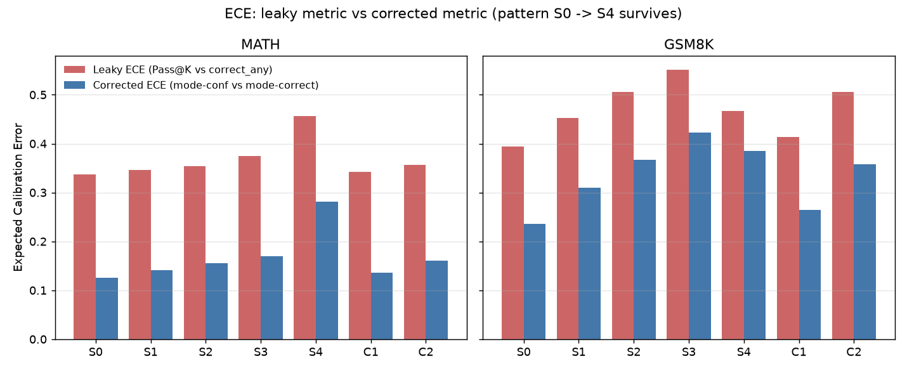
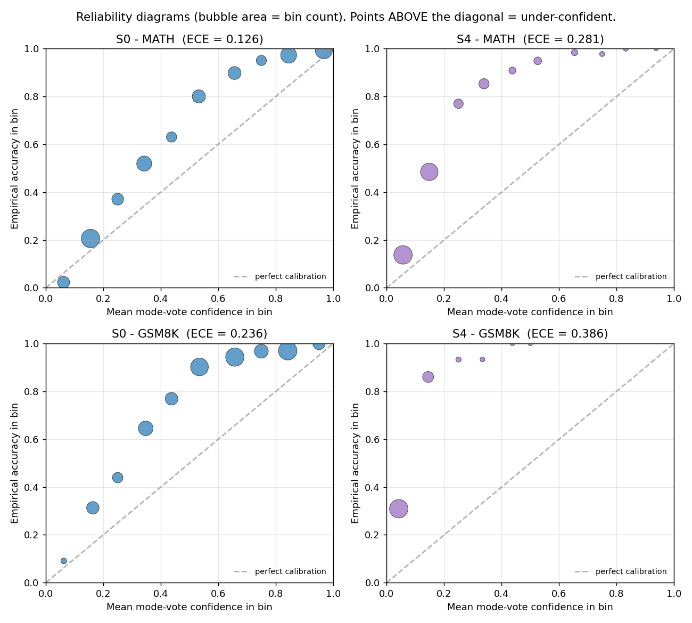
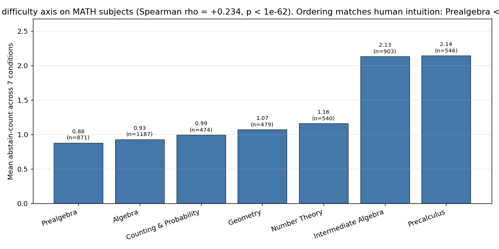
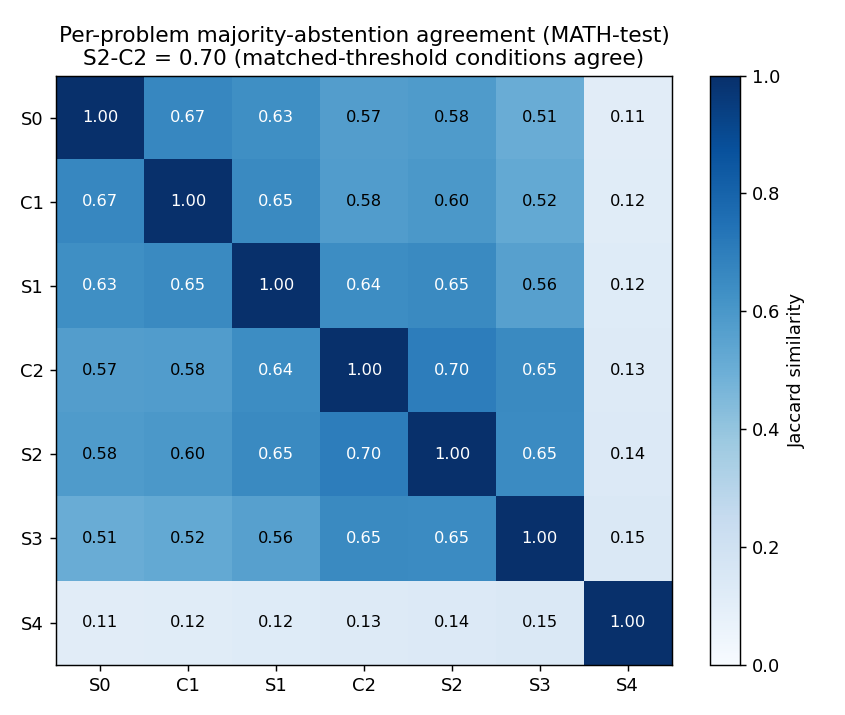
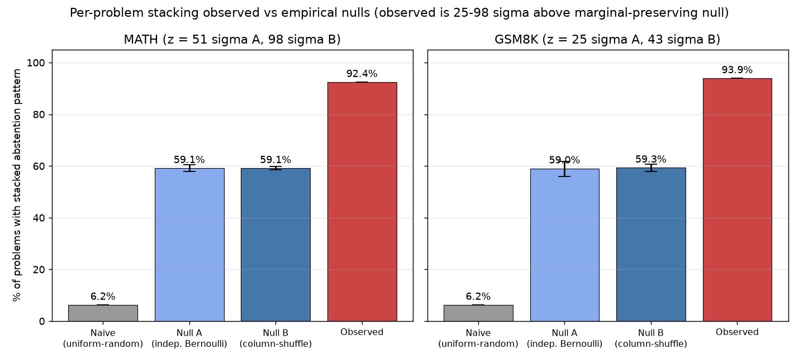

# FEAR: Fear-Enhanced Asymmetric Rewards for LLM Calibration

> **Note (2026-10-18).** In this project's TruthfulQA-MC data the correct option is always listed first and options were never shuffled, so TruthfulQA-MC accuracy, calibration and probe numbers below measure how often the model picks option A. Only abstention rates on TruthfulQA-MC remain meaningful. See RESULTS.md section 5.

**An End-to-End Project Report (Phases 0 - 3 complete; Phases 4 - 5 designed)**

Authors: Rahul Krishnan and Sanjana Deshpande
Advisor: Prof. Dr. Achim Rettinger
Institution: University of Trier, Department of Computational Linguistics
Report date: 2026-05-25

---

## Abstract

This report documents an end-to-end research investigation of FEAR (Fear-Enhanced Asymmetric Rewards), a family of asymmetric reinforcement-learning rewards designed to teach a Large Language Model (LLM) when to answer and when to stay silent on mathematical reasoning problems. Seven reward conditions (S0 through S4, plus C1 and C2) were trained on Qwen 2.5 1.5B via Group Relative Policy Optimization (GRPO) with Low-Rank Adaptation (LoRA) adapters, evaluated across six benchmarks (MATH, GSM8K, AIME 2024, AIME 2025, MMLU-STEM, TruthfulQA-MC) at K=16 rollouts per problem, and analyzed offline for calibration, selective prediction, per-problem stacking, and cross-condition agreement. Twenty-three publication-grade findings emerged from the analysis; the codex peer-review process retained three as SOUND, one as UNDERSTATED, and five as OVERSTATED-now-tightened, with three follow-up experiments still required before the strongest claims can be promoted to publication-defensible status. Ten of thirteen planned training runs are complete. This report is layman-readable and replicable from the commands in Section 8.

---

## Table of Contents

- Section 1. Model Architecture, Software Stack, and Infrastructure
- Section 2. Datasets
- Section 3. Reference Trace Generation (Phase 1 Experiment)
- Section 4. Reward Conditions, Training Procedure, and Verification
- Section 5. Experiment 1 Results, Insights, and Future Directions
- Section 6. Open Action Items and Concerns
- Section 7. Glossary of Abbreviations
- Section 8. Reproduction Recipe
- Section 9. References

---

# Section 1: Model Architecture, Software Stack, and Infrastructure

## 1.1 The Primary Model: Qwen 2.5 1.5B

The model at the center of all FEAR (Fear-Enhanced Asymmetric Rewards) experiments is **Qwen 2.5 1.5B base**, available on HuggingFace (HF) under the identifier `Qwen/Qwen2.5-1.5B`. The "1.5B" refers to 1.5 billion trainable parameters. To put that in perspective, a parameter is a single numerical weight in the neural network; 1.5 billion of them collectively encode everything the model knows about language, reasoning, and mathematics from its pre-training phase.

Qwen 2.5 1.5B is a decoder-only transformer LLM (Large Language Model). "Decoder-only" means the model reads a prompt and generates a continuation token by token, which is the standard architecture behind models like GPT and LLaMA. "Transformer" is the underlying architectural family that uses attention mechanisms to let every part of the input influence every other part when forming a representation.

### Why 1.5B and Not 7B?

A natural question is why a 1.5B model was chosen instead of a 7B model, which would typically produce stronger baseline results and carry more credibility at venues like ICLR (International Conference on Learning Representations). The answer is the compute budget. Training under RL (Reinforcement Learning) with GRPO (Group Relative Policy Optimization, explained in detail in Section 4) requires that the model and the rollout engine co-reside on a single GPU during training. On the available A100 40 GB card, a 7B model at bf16 (bfloat16) precision together with a co-resident vLLM (a fast batched inference engine, described below) rollout engine exhausts GPU memory before any training can begin. The 1.5B model leaves comfortable headroom: roughly 3 GB for the policy, 3 GB for vLLM, 1 GB for the KV cache, 5 GB for the logits buffer, and 1 GB for activations, around 13 GB of 40 GB, well within budget.

### Why Qwen and Not Llama?

Two alternative model families were considered: Llama 3.2 3B and Qwen 2.5 1.5B. The literature review resolved this cleanly. Chen et al. [2025] (SimpleRL-Zoo) and Zhu et al. [2025] both find that Llama-family base models struggle to bootstrap mathematical reasoning from zero under RL. The reason is pretraining: Llama models are pretrained on a general web corpus with relatively little emphasis on mathematics and code. Qwen 2.5, by contrast, was pretrained with a substantially heavier mathematics and code mixture. This latent mathematical capability already exists in the model's weights before RL training begins; asymmetric reward can then amplify it. Choosing Llama would risk attributing null or weak results to the reward design when the real cause would be the absence of a mathematical foundation to build on.

## 1.2 Tokenizer

Text is fed to the model as a sequence of integer tokens. The tokenizer is the component that converts raw text into those integers and back. The fast variant of HuggingFace's `AutoTokenizer` is used throughout. "Fast" refers to a Rust-accelerated implementation that handles batch tokenization efficiently on the CPU while the GPU processes model computations.

## 1.3 Adapter-Based Training with LoRA and PEFT

Training all 1.5 billion parameters of the model for each of the 13 experimental conditions (7 reward conditions, with 3 seeds on the headline conditions) would require storing 13 complete copies of a 3 GB model, totalling roughly 40 GB of adapter storage, plus incurring the full gradient-memory cost of updating every parameter. LoRA (Low-Rank Adaptation), part of the PEFT (Parameter-Efficient Fine-Tuning) library, solves this.

The core idea of LoRA is as follows. Instead of updating the original weight matrix W (which might be 4096 x 4096 in a large model), LoRA freezes W entirely and adds a small side path: two rectangular matrices A and B with rank r, so that the effective update is W + A * B. With r = 16 and dimensions 4096 x 4096, the full matrix has 16.7 million parameters; the LoRA update has only 2 x (4096 x 16) = 131 072 parameters, a 128x reduction. After training, A * B is merged back into W and the original model is indistinguishable from a fully fine-tuned version at inference time, but only the small adapter file (around 30 MB per condition-seed pair) needed to be stored and pushed to HF.

The LoRA configuration used in all experiments is:

```yaml
lora:
  r: 16
  alpha: 32
  dropout: 0.05
  target_modules: [q_proj, k_proj, v_proj, o_proj, gate_proj, up_proj, down_proj]
```

`r: 16` sets the rank of the low-rank update matrices. `alpha: 32` is a scaling factor for the adapter outputs (effectively a learning-rate multiplier for the LoRA path; the ratio alpha/r = 2 is a standard default). `dropout: 0.05` randomly zeros 5% of adapter activations during training, acting as light regularization. `target_modules` lists the seven linear projection layers inside each transformer block where LoRA is applied: the query (`q_proj`), key (`k_proj`), value (`v_proj`), and output (`o_proj`) projections of the self-attention mechanism, and the gate, up, and down projections of the MLP (multi-layer perceptron) feed-forward sublayer. Covering all seven projections is standard practice for math-reasoning RL fine-tuning and ensures the adapter has access to the full information flow through each block.

## 1.4 Numerical Precision: bf16 and fp16

Floating-point precision determines how numbers are stored in GPU memory. Two formats are relevant here.

bf16 (bfloat16) is the preferred format for training on Ampere-generation NVIDIA GPUs such as the A100. It has the same exponent range as 32-bit floats but a shorter mantissa, making it memory-efficient while remaining numerically stable during gradient updates. The A100 has dedicated bf16 tensor cores that make bf16 arithmetic faster than fp16 (float16) on that card.

fp16 (float16) is used as a fallback on older GPU generations, specifically on the RTX 2080 Ti and V100 cards available for evaluation. These Turing and Volta generation GPUs lack native bf16 hardware support. Attempting bf16 on those cards triggers a Triton (a GPU kernel compiler) error about MMA (matrix multiply-accumulate) layout conversions being unsupported outside Ampere.

The `eval_calibration.py` script resolves this automatically via the `--dtype auto` flag, which queries the GPU's compute capability (cc): if cc >= 8 (Ampere or newer), bf16 is selected; otherwise fp16 is used. Additionally, the vLLM monkeypatch in `grpo.py` forces fp16 inside vLLM regardless of the policy's dtype, because vLLM 0.6.4 also rejects bf16 on sub-Ampere hardware.

## 1.5 Hardware Infrastructure

Two physically separate server environments are used.

**Training server (Orion):** a single NVIDIA A100 40 GB. All GRPO training runs execute exclusively on this machine. No training or inference commands are run on the development laptop; the workflow is to edit code locally, push to git, pull on the server, and launch training inside a tmux session so the job survives SSH disconnects.

**Evaluation server (alias):** five RTX 2080 Ti GPUs (11 GB each) and one V100 (reserved, not used for active eval due to vLLM incompatibility at the current TRL/Triton stack). Evaluation is inference-only and fits one (condition, seed) combination per 2080 Ti, enabling five conditions to be evaluated in parallel. The V100 is excluded from active evaluation because vLLM 0.6.4 with Triton 3.1 dropped Volta-generation MMA support.

## 1.6 vLLM: Fast Batched Inference

vLLM (version 0.6.4) is a high-throughput inference engine for LLMs. Rather than generating one token at a time sequentially, vLLM uses paged attention and continuous batching to maximize GPU utilization across many concurrent sequences. During GRPO training, vLLM is loaded co-resident on the same GPU as the policy model, consuming 40% of the 40 GB memory (set via `vllm_gpu_memory_utilization: 0.40`, corresponding to 16 GB), which is enough for the model weights plus a large KV cache for batching. At evaluation time, a separate vLLM engine runs on each 2080 Ti.

## 1.7 The Trainer: TRL and GRPO

Training uses TRL (Transformer Reinforcement Learning) version 0.15.2, the HuggingFace library that provides RL fine-tuning utilities for LLMs. Specifically, the `GRPOTrainer` class is used. GRPO (Group Relative Policy Optimization) is an RL algorithm introduced in DeepSeekMath [Shao et al., 2024] that eliminates the need for a separate value/critic model. For each prompt, G completions are sampled (G = 8 in production), each scored by the reward function, z-score normalized within the group, and used as advantages to update the policy via a clipped policy gradient objective with a KL (Kullback-Leibler) divergence penalty against the frozen base model. The KL penalty prevents the policy from drifting too far from the base model's distribution. Full GRPO details and all hyperparameter choices are discussed in Section 4.

## 1.8 Complete Software Stack

The full dependency versions pinned in the `asym-rewards` Conda environment (Python 3.11, at `/opt/anaconda` on the servers) are:

| Package | Version |
|---|---|
| torch | 2.5.1+cu124 |
| transformers | 4.46.3 |
| trl | 0.15.2 |
| peft | 0.13.2 |
| accelerate | 1.1.1 |
| vllm | 0.6.4 |
| datasets | 3.1.0 |
| numpy | <2 |
| math-verify | (latest at env creation) |
| ollama | (for trace generation, Phase 1) |

The `math_verify` package is used for all answer correctness checks. It handles LaTeX-format answers (fractions, square roots, nested expressions) via symbolic parsing rather than string equality, which is essential for MATH and AIME (American Invitational Mathematics Examination) problems where many equivalent representations exist for the same answer.

## 1.9 Adapter Naming and Storage

Each trained adapter is saved locally under `outputs/grpo/qwen2_5_1_5b_{COND}_s{SEED}/` and pushed to a private HF repository named `ndsanjana/fear-qwen2_5_1_5b-{COND}-s{SEED}`. As of the writing of this section, the 10 completed training runs have the following HF repository IDs:

| Run tag | Seed | HF Repository |
|---|---|---|
| S0_s42 | 42 | `ndsanjana/fear-qwen2_5_1_5b-S0-s42` |
| S1_s42 | 42 | `ndsanjana/fear-qwen2_5_1_5b-S1-s42` |
| S2_s42 | 42 | `ndsanjana/fear-qwen2_5_1_5b-S2-s42` |
| S3_s42 | 42 | `ndsanjana/fear-qwen2_5_1_5b-S3-s42` |
| S4_s42 | 42 | `ndsanjana/fear-qwen2_5_1_5b-S4-s42` |
| C1_s42 | 42 | `ndsanjana/fear-qwen2_5_1_5b-C1-s42` |
| C2_s42 | 42 | `ndsanjana/fear-qwen2_5_1_5b-C2-s42` |
| S0_s123 | 123 | `ndsanjana/fear-qwen2_5_1_5b-S0-s123` |
| S3_s123 | 123 | `ndsanjana/fear-qwen2_5_1_5b-S3-s123` |
| C2_s123 | 123 | `ndsanjana/fear-qwen2_5_1_5b-C2-s123` |

Three additional runs (S0/S3/C2 at seed=456) are in progress or pending at the time of writing.

## 1.10 Reproducibility

The default random seed is 42. For multi-seed experiments, each seed propagates through `GRPOConfig.seed`, the run name, the output directory suffix, and the HF repository name, so no two runs can collide. During evaluation, per-rollout seeds are derived deterministically from the problem identifier and sample index using:

```python
seed_for(problem_id, sample_idx) = int.from_bytes(
    sha256(f"{problem_id}:{sample_idx}").digest()[:4], "big"
) % (2**31)
```

This ensures that every evaluation is reproducible across machines and that any evaluation run can be restarted mid-way without re-sampling already-completed rollouts.

---

# Section 2: Datasets

## 2.1 Overview and Design Rationale

Eleven datasets are used across the FEAR (Fear-Enhanced Asymmetric Rewards) project. They fall into four functional groups: training corpora, in-domain evaluation benchmarks, out-of-domain (OOD) evaluation benchmarks, and an error-detection ground-truth corpus. The choice of datasets follows a single organising principle: mathematical reasoning is the training domain throughout, and every evaluation benchmark either stays inside that domain (to measure calibration on familiar territory) or probes an adjacent domain (to test whether the calibration improvements transfer). This "same-domain-throughout" principle is not cosmetic. It ensures that when a model is evaluated on an error-detection benchmark in Phase 5, the benchmark is drawn from the same distribution the model was trained and evaluated on, making the evaluation internally consistent and the results interpretable.

All datasets are preprocessed by a single entry point, `scripts/prepare_data.py`, which is invoked via `make data`. The script downloads each dataset, normalises column names to a shared schema, applies any necessary filtering, and writes the result to `data/processed/{name}.parquet` (or `.jsonl` for PRM800K). Once written, subsequent runs skip already-processed files.

Two prompt templates are used across all benchmarks. For free-response mathematical problems the template is:

```
Solve the following problem step by step. Put your final answer in \boxed{}.

Problem: {problem}
```

For multiple-choice questions (MMLU and TruthfulQA) the template is:

```
Answer the following multiple-choice question. Put the letter of your chosen answer in \boxed{}.

Question: {question}
A) {choice_A}
B) {choice_B}
C) {choice_C}
D) {choice_D}
```

Answer extraction from model outputs uses `extract_boxed_answer()`, a brace-depth-aware regex that finds the last `\boxed{...}` occurrence in any response. Correctness is judged by `math_verify.verify()`, which is tolerant of mathematically equivalent representations: fractions, surds, decimal approximations, and algebraic simplifications that a string-equality check would reject.

## 2.2 Training Datasets

### MATH-train

- **Source:** HuggingFace (HF) repository `DigitalLearningGmbH/MATH-lighteval`
- **Size:** 7,500 rows
- **Schema columns:** `id`, `prompt`, `answer`, `level` (integer 1-5), `subject`, `split`, `source`
- **Purpose:** Primary Reinforcement Learning (RL) training corpus for free-response mathematical problems
- **Subset used:** Levels 4-5 only (~1,800 rows), selected to ensure the model is challenged on problems where incorrect answers are plausible, making the asymmetric reward signal informative

The MATH benchmark (the Hendrycks competition math dataset) is the standard benchmark for evaluating mathematical reasoning in Large Language Models (LLMs). The canonical HF copy under `hendrycks/competition_math` was removed from the platform; `DigitalLearningGmbH/MATH-lighteval` is the currently accessible mirror and is used throughout. Problems are filtered to difficulty levels 4 and 5 because lower-difficulty problems are solved reliably by modern LLMs with no RL training. On easy problems the reward signal collapses, every group sample gets the same reward, so the GRPO (Group Relative Policy Optimization) normalisation step divides by near-zero variance and produces no useful gradient. Hard problems create the reward variation that the training depends on.

Sample entry:

```
id:      math_train_0
prompt:  "Find the degree of the polynomial (x^2+1)^3 + x^4."
answer:  "6"
level:   1
subject: "algebra"
split:   "train"
source:  "MATH"
```

### GSM8K-train

- **Source:** HF repository `gsm8k`
- **Size:** 7,473 rows (full training split); ~1,800 rows after filtering
- **Schema columns:** `id`, `prompt`, `answer` (final numeric value), `split`, `source`
- **Purpose:** Secondary RL training corpus; provides shorter reasoning chains and grade-school arithmetic alongside the harder MATH problems

GSM8K (Grade School Math 8K) contains multi-step arithmetic word problems whose answers are single integers. The full training split is filtered to the top quartile by prompt token length (~1,800 rows). Longer GSM8K problems require more reasoning steps and produce more varied rollout behaviour, which makes the reward signal informative. Short, trivially-solved problems would again collapse the GRPO variance and contribute noise rather than signal.

Sample entry:

```
id:      gsm8k_train_0
prompt:  "Natalie has 22 more apples than Mia. Together they have 58 apples.
          How many apples does Mia have?"
answer:  "18"
split:   "train"
source:  "GSM8K"
```

## 2.3 In-Domain Evaluation Benchmarks

### MATH-test

- **Source:** Same HF repository as MATH-train (`DigitalLearningGmbH/MATH-lighteval`)
- **Size:** 5,000 rows
- **Purpose:** Primary evaluation benchmark; same distribution as training, enabling direct measurement of in-domain calibration

### GSM8K-test

- **Source:** HF repository `gsm8k`
- **Size:** 1,319 rows
- **Purpose:** In-domain evaluation on shorter reasoning chains; captures the easier end of the arithmetic difficulty spectrum

These two benchmarks form the centre of the evaluation suite. Because the model is trained on subsets of their training splits, performance here reflects in-distribution calibration, the most favourable setting. The contrast between MATH-test (harder) and GSM8K-test (easier) already provides a mini-difficulty gradient within the in-domain set.

## 2.4 Hard and OOD Mathematical Evaluation Benchmarks

The following five benchmarks form a difficulty gradient that extends well beyond the training distribution. Together they answer whether the calibration signal induced by FEAR training is meaningful only at medium difficulty or whether it scales to competition-level problems.

### AIME 2024

- **Source:** HF repository `Maxwell-Jia/AIME_2024`
- **Size:** 30 rows
- **Schema columns:** `id`, `prompt`, `answer` (integer 0-999), `split`, `source`
- **Purpose:** Hard evaluation; AIME (American Invitational Mathematics Examination) problems require multiple pages of algebraic manipulation. At 1.5B parameter scale, accuracy is expected near the noise floor; the metric of interest is abstention rate, that is, whether the model recognises that it does not know.

### AIME 2025

- **Source:** HF repository `opencompass/AIME2025`, two configs `AIME2025-I` and `AIME2025-II`
- **Size:** 30 rows total (15 per config)
- **Purpose:** Same as AIME 2024; the 2025 edition is included because it is entirely unseen during training and avoids any contamination risk from the 2024 problems appearing in the model's pretraining data

Note: ARC-Challenge (a multiple-choice science benchmark) was originally planned for this slot and was rejected. A model trained exclusively on mathematical RL has no reason to perform well on science MCQ. Calibration measurements on a task where the model is uniformly incompetent would be meaningless. AIME 2025 replaces it with a same-domain, appropriately hard alternative.

### MATH-Hard

- **Source:** HF repository `lighteval/MATH-Hard`
- **Size:** 1,324 rows
- **Purpose:** A curated harder subset of the MATH benchmark; provides a dense difficulty tier between MATH-test (all levels) and AIME

### MATH-500

- **Source:** HF repository `HuggingFaceH4/MATH-500`
- **Size:** 500 rows
- **Purpose:** A balanced, level-stratified slice of the MATH test set frequently used in published comparison tables; included to allow direct comparison with prior work

### OlympiadBench

- **Source:** HF repository `Hothan/OlympiadBench`, config `OE_TO_maths_en_COMP`
- **Size:** 674 rows
- **Purpose:** Olympiad-level mathematical competition problems; the hardest mathematical evaluation tier in the suite, above AIME in expected difficulty

## 2.5 Cross-Domain Calibration Benchmarks (OOD Calibration Probes)

A central ICLR-facing contribution of the project is the claim that FEAR-induced abstention behaviour transfers outside mathematics. The following two benchmarks test whether the abstention threshold the model internalises during math training generalises to domains it was not trained on.

### MMLU-STEM

- **Source:** HF repository `cais/mmlu`, filtered to STEM (Science, Technology, Engineering, and Mathematics) subjects
- **Size:** 3,153 rows across 19 STEM subjects
- **Schema columns:** `id`, `prompt`, `choices` (list of 4 strings), `answer` (integer index 0-3), `subject`, `split`, `source`
- **Purpose:** Cross-domain calibration probe; if FEAR-trained models abstain more on hard STEM MCQ (Multiple-Choice Questions) than FEAR-naive baselines, the threshold has generalised

Sample entry:

```
id:      mmlu_stem_0
prompt:  "What is the boiling point of water at 1 atm?"
choices: ["50 C", "75 C", "100 C", "125 C"]
answer:  2
subject: "college_chemistry"
split:   "test"
source:  "MMLU"
```

### TruthfulQA-MC

- **Source:** HF repository `truthful_qa`, config `multiple_choice`
- **Size:** 817 rows
- **Schema columns:** `id`, `prompt`, `mc1_targets` (dict with `choices` list and multi-hot `labels`), `mc2_targets` (same structure for multi-answer scoring), `split`, `source`
- **Purpose:** General-knowledge OOD calibration probe; tests whether the model's silence-when-uncertain behaviour transfers to factual domains with no mathematical content

TruthfulQA is a benchmark of questions designed to elicit confidently wrong answers from overconfident models (common misconceptions, plausible-sounding falsehoods). An abstention-trained model should abstain more on these than a symmetric baseline if the abstention threshold has truly generalised. This benchmark replaced ARC-Challenge in the evaluation suite. ARC-Challenge was rejected for the same reason as the AIME slot: a math-trained model has no domain-transfer motivation to perform well on science MCQ. TruthfulQA-MC is general-knowledge and not tied to any single domain, making it a fairer cross-domain probe.

## 2.6 Error-Detection Ground Truth (Phase 5)

### PRM800K Phase 2 Train and Test

- **Source:** GitHub repository `openai/prm800k` (NOT on HuggingFace); files `phase2_train.jsonl` and `phase2_test.jsonl` extracted after cloning
- **Size:** Approximately 800,000 human-annotated reasoning steps in total across both phases; Phase 2 train and test are the subset used here
- **Schema columns:** `problem`, `solution` (list of reasoning steps), `label` (+1 correct, 0 neutral, -1 incorrect), `annotator`, `split`, `source`
- **Purpose:** Ground truth for Experiment 3 (zero-shot judge evaluation in Phase 5); provides human step-level correctness labels on model-generated MATH solutions

PRM800K (Process Reward Model 800K) is the dataset released by Lightman et al. (OpenAI, 2023) in "Let's Verify Step by Step." Human annotators labelled each individual reasoning step in a large collection of LLM-generated MATH solutions as correct (+1), neutral (0), or incorrect (-1). This benchmark was chosen over JudgeBench, which was originally planned for this role. JudgeBench is a domain-general benchmark spanning many NLP evaluation tasks. The "same-domain-throughout" principle requires that the error-detection evaluation share its domain with the training data. PRM800K is entirely within mathematical reasoning, the same domain as MATH-train and MATH-test, making it the correct choice.

**Status at the time of this report:** PRM800K is downloaded and preprocessed; it is NOT yet used in any experiment. Its activation point is Phase 5 (Experiment 3), described in Section 6.

## 2.7 The Difficulty Gradient: Reading the Evaluation Suite as a Whole

The six evaluation benchmarks that are active during Experiments 1 and 2 are not an arbitrary collection. They form a deliberate structure:

- **Easy end:** GSM8K-test, grade-school arithmetic, single-integer answers, high per-step correctness
- **Medium:** MATH-500 and MATH-test, undergraduate competition math, varied subjects and formats
- **Hard:** MATH-Hard, curated harder subset of the same benchmark
- **Very hard:** AIME 2024 and AIME 2025, national competition problems, near-zero accuracy expected at 1.5B scale
- **Expert level:** OlympiadBench, international olympiad problems

Alongside this difficulty spine sit the two cross-domain probes (MMLU-STEM and TruthfulQA-MC). This layout means that every calibration metric, abstention rate, Expected Calibration Error (ECE), and selective accuracy, can be read at multiple difficulty levels simultaneously. If asymmetric reward training genuinely induces a meaningful confidence threshold, the abstention rate should rise monotonically as problems get harder. Sections 4 and 5 report whether this prediction holds.

---

# Section 3: Reference Trace Generation (Phase 1 Experiment)

## 3.1 Why This Experiment Was Needed

Before any FEAR (Fear-Enhanced Asymmetric Rewards) models are trained, Phase 1 generates a corpus of external reasoning traces that will serve as the evaluation material for Experiment 3 in Phase 5. Experiment 3 asks whether a FEAR-trained model becomes a better judge of mathematical reasoning, specifically whether it can identify which steps in another model's solution are incorrect. To measure this, a collection of solutions is needed that has two properties: (a) each solution is labelled for correctness, and (b) each collection of solutions for a given problem contains a mix of correct and incorrect examples so the judge has something to discriminate. This section describes how that collection was built.

The reference trace generation experiment is structurally independent of everything in Phases 2-4. It does not train any model and does not use any FEAR reward. It produces a static dataset, 6,000 model-generated reasoning traces scored for correctness, that sits dormant until Phase 5 activates it. Section 6 covers the current status of Phase 5.

## 3.2 What Was Generated

For each of 500 randomly subsampled MATH Level 4-5 training problems, 4 independent reasoning traces were generated (k=4), producing 2,000 MATH traces. For each of 500 randomly subsampled GSM8K (Grade School Math 8K) training problems, 8 traces were generated (k=8), producing 4,000 GSM8K traces. The total corpus is 6,000 traces across 1,000 distinct problems.

The choice of k differs between the two datasets for a statistical reason. MATH Level 4-5 problems are hard: the generator solves roughly 36% of them correctly. With k=4, the binomial probability of obtaining at least one correct and at least one incorrect trace per problem (a "mixed-class" problem, usable as a judge-evaluation item) is approximately 75%. GSM8K problems are easier: the generator solves 64% correctly, so k=4 would produce too many all-correct problems. With k=8, the mixed-class probability stays high enough to build a usable evaluation pool.

Each trace was scored immediately after generation. `extract_boxed_answer()` extracts the final `\boxed{...}` expression from the trace text. `math_verify.verify()` compares the extracted expression against the gold answer, tolerating mathematically equivalent representations. Each trace is labelled `correct=True` or `correct=False`.

## 3.3 The Generator Model

Traces were generated using `qwen3:30b` MoE (Mixture of Experts) A3B, that is, Qwen3 30B architecture with approximately 3 billion active parameters per forward pass, served via a local ollama daemon on the server. The ollama service ran on 2 of the server's RTX 2080 Ti GPU (Graphics Processing Unit) cards in a split-model configuration.

The choice of generator model was made on three grounds. First, it needed to be stronger than the Qwen 2.5 1.5B base model being trained, so that its traces represent meaningful reasoning diversity rather than noise. A 30B-class model satisfies this. Second, it needed to run locally without API costs, since 6,000 long-form reasoning traces at cloud pricing would be prohibitive. Third, a bootstrapping seed of 150 samples was also generated via the `deepseek-v4-flash-free` cloud model through the OpenCode Zen interface, for early validation of the pipeline before committing to the full local run.

The generator was deliberately NOT the same model family being trained. Using the trained Qwen 1.5B adapters to generate the traces would be circular: the training data and the judge target would share a base model, introducing a bias toward the base model's own failure modes. The trained adapters are reserved for Phase 5, where they act as judges of these externally-generated traces, and that separation is what makes the evaluation clean.

## 3.4 Generation Parameters

Each trace was generated with the following fixed parameters:

- Temperature: 0.7 (controls stochasticity of the output; 0.0 would be fully deterministic, 1.0 fully random)
- Maximum tokens (`n_predict`): 4,096
- Reasoning mode: ON (Qwen3 produces an internal chain-of-thought tagged with `<think>...</think>`; this thinking field was captured separately and then concatenated to the response text before storage)
- Per-sample seed: a stable SHA-256 hash of the string `{problem_id}:{sample_idx}`, truncated to 4 bytes modulo 2^31. This makes individual sample seeds deterministic and reproducible without requiring a global seed that would correlate samples.

The generation script flushed intermediate results to disk every 50 samples as a parquet checkpoint, so that a server disconnection or process interruption could be resumed from the last checkpoint rather than restarting from zero. Deduplication on the `(problem_id, sample_idx)` tuple ensured that restarted runs did not create duplicate entries. Exponential backoff was applied on HTTP 429 (rate-limit) and 5xx (server-error) responses from the ollama API.

## 3.5 Output Schema and Files

Each generated trace is stored as one row with the following columns:

| Column | Type | Description |
|---|---|---|
| `problem_id` | string | Unique identifier of the source problem |
| `sample_idx` | integer | Which of the k traces for this problem (0-indexed) |
| `seed` | integer | Per-sample deterministic seed used at generation time |
| `problem` | string | The full problem text as passed to the generator |
| `level` | integer | MATH difficulty level (4 or 5); null for GSM8K |
| `gold_answer` | string | The reference answer from the dataset |
| `trace` | string | Full model response including `<think>...</think>` block |
| `extracted_answer` | string | Result of `extract_boxed_answer()` on the trace; empty string if no boxed answer found |
| `correct` | boolean | Whether `math_verify.verify(extracted_answer, gold_answer)` returned True |
| `n_tokens` | integer | Number of tokens in the trace (as reported by the ollama response) |
| `model` | string | Generator model tag (e.g., `qwen3:30b`) |
| `gen_seconds` | float | Wall-clock generation time for this sample in seconds |

Output files:
- `data/processed/reference_traces_math_train.parquet` for MATH Level 4-5 traces
- `data/processed/reference_traces_gsm8k_train.parquet` for GSM8K traces

## 3.6 Results

The table below summarises the full generation run (excluding the smoke-test preruns):

| Benchmark | Samples | Problems | % correct | Mean tokens | Median tokens | Mixed (Exp-3 ready) | All-correct | All-wrong |
|---|---|---|---|---|---|---|---|---|
| MATH L4-L5 | 2,000 | 500 | 36.1% | 3,435 | 4,096 | 112 | 125 | 263 |
| GSM8K train | 4,000 | 500 | 64.0% | 839 | 885 | 187 | 216 | 97 |

MATH per-level breakdown: Level 4 = 50.2% correct (n=856 traces), Level 5 = 25.6% correct (n=1,144 traces).

The Experiment 3 mixed-class pool contains 299 problems total: 112 from MATH Level 4-5 and 187 from GSM8K. These are the problems where at least one of the k traces is correct and at least one is incorrect, the minimum requirement for a discriminative judge-evaluation item.

## 3.7 Generator Comparison

Before committing to the full generation run, a smoke comparison was conducted on a small sample to select the generator model. Three candidates were tested:

| Generator | MATH-L4/5 (20 samples) | GSM8K (40 samples) | MATH % correct | L5 % correct | Mixed problems |
|---|---|---|---|---|---|
| qwen3:32b dense (V100 + 4x 2080 Ti split) | 183 min | 91 min | 40% | 25% | 0 / 4 |
| qwen3:30b MoE A3B (2x 2080 Ti split) | 17.6 min | 7.6 min | 40% | 25% | 0 / 1 |
| deepseek-v4-flash-free (cloud) | 6.5 min | 3.0 min | 65% | 56% | 1 / 1 |

The dense 32B model and the MoE 30B model achieved identical MATH accuracy (40% on L4-L5; 25% on L5 alone) at the smoke scale. The MoE model was 10x faster, requiring only 2 GPU cards instead of 5. This makes the MoE model the clear choice for local generation: equal quality at a tenth of the wall time. The cloud model (`deepseek-v4-flash-free`) was stronger at 65% MATH accuracy, but its free tier allowed only 150 samples before rate limits. Those 150 samples were retained as a high-quality bootstrap seed for early pipeline validation.

Total wall time for the full run: approximately 26 hours of active generation (42 hours end-to-end, including idle periods between batches). The GSM8K phase required 847.8 minutes for 4,000 samples (approximately 12.7 seconds per sample). The MATH phase required approximately 720 minutes for 2,000 samples.

## 3.8 Known Limitation: MATH Token Truncation

The MATH median token count in the results table is 4,096, equal to the `n_predict` hard cap. This means more than half of all MATH Level 4-5 traces were cut off before the model finished reasoning. A truncated trace almost never ends with a `\boxed{}` expression, so `extract_boxed_answer()` returns empty and the trace is labelled incorrect.

This means the MATH incorrect-label rate is inflated by truncation, not by genuine reasoning failure. The "all-wrong" count of 263 out of 500 MATH problems reflects this: on many of those problems the generator may have been capable of producing a correct trace with a longer context window, but the 4,096-token cap prevented it.

This limitation has two practical consequences for the project:

1. The MATH mixed-class rate of 22% (112/500) is partly a truncation artifact. The true mixed-class rate under a larger context window would likely be higher.
2. GSM8K is the primary Experiment 3 source (mixed-class rate 37%, 187/500) and MATH is the harder secondary. GSM8K traces are short (median 885 tokens, well below the cap), so truncation does not affect GSM8K labels. Any analysis that relies on the correctness labels as genuine reasoning-quality signals should weight GSM8K more heavily.

The 4,096-token cap was a pragmatic constraint imposed by the server's available GPU memory for 6,000 long-form generations. Increasing it would require either a larger-memory node or switching to a smaller generator model, both of which would change the quality of the traces. The limitation is noted in the methodology rather than corrected, and the GSM8K-primary framing for Experiment 3 is the appropriate response.

## 3.9 Status and Forward Pointer

The reference trace corpus is complete and stored at the output paths listed in Section 3.5. It is not used in Phases 2, 3, or 4. Those phases concern the FEAR reward conditions, the trained Qwen 2.5 1.5B LoRA (Low-Rank Adaptation) adapters, and the calibration and internal-representation experiments, all of which operate on the six evaluation benchmarks described in Section 2 rather than on the generated traces. The trace corpus activates in Phase 5 (Experiment 3), where each of the 299 mixed-class problems becomes a judge-evaluation item: a FEAR-trained adapter is presented with both the correct and incorrect traces for a problem and asked to label which reasoning steps are erroneous, with agreement against the PRM800K human labels as the ground truth. Section 6 reports the current status of Phase 5.

---

# Section 4: Reward Conditions, Training Procedure, and Verification

## 4.1 The Core Reward Signal

FEAR (Fear-Enhanced Asymmetric Rewards) is defined by a simple asymmetric scalar reward function. Every time the model generates a response to a math problem, it receives one of three possible reward values depending on what it did:

- If the response contains a correct boxed answer, the reward is `+alpha`.
- If the response contains an incorrect boxed answer, the reward is `-beta`.
- If the response contains no boxed answer at all (the model stayed silent), the reward is `+abstain`.

Abstention is detected purely by the absence of a `\boxed{...}` expression in the model's output. There is no special "I don't know" token, no dedicated abstention head, and no changes to the model's vocabulary. The model learns to be silent by simply not producing a `\boxed{}` expression. The reward function in source form is:

```python
def asymmetric_reward(completion, gold, alpha, beta, abstain=0.0):
    extracted = extract_boxed_answer(completion)
    if not extracted:
        return abstain
    return alpha if is_correct(extracted, gold) else -beta
```

Answer correctness is checked with `math_verify`, which parses both the model's answer and the gold answer as mathematical expressions and compares them symbolically. This handles LaTeX-format answers such as `\frac{1}{2}`, `\sqrt{3}`, and numeric equivalences that string comparison would miss.

## 4.2 The EV-Implied Abstention Threshold

The behavioral effect of the three reward values can be understood through EV (Expected Value) theory. A model with a calibrated belief that it will answer correctly with probability `p` faces two choices: attempt the problem or stay silent.

- EV of attempting: `p * alpha - (1 - p) * beta`
- EV of staying silent: `abstain`

An EV-rational agent attempts if and only if `p * alpha - (1 - p) * beta > abstain`, which rearranges to `p > (beta + abstain) / (alpha + beta)`. This ratio is called the EV-implied abstention threshold. When the model's confidence falls below this threshold, the rational action under the reward signal is to stay silent.

This formula makes explicit the design space: `alpha` controls the reward for success, `beta` controls the penalty for failure, and `abstain` controls the floor reward for silence. By adjusting these three numbers, different thresholds can be targeted without retraining the overall architecture.

## 4.3 The Seven Reward Conditions

Seven distinct reward configurations are studied. The conditions split into two families.

The **S-family** (S0 through S4) holds `abstain = 0.0` and varies the `alpha/beta` ratio to sweep the EV-implied threshold from 0.50 (symmetric) to 1.00 (degenerate). These are called implicit-abstention conditions because the model learns to abstain only by discovering that silence avoids the `-beta` penalty, not because silence is explicitly rewarded.

The **C-family** (C1 and C2) holds `alpha = beta = 1.0` and increases the `abstain` reward to a positive value, so the model receives explicit positive feedback for staying silent on problems it is unsure about. These are called explicit-abstention conditions.

The full parameter matrix is:

| Condition | alpha | beta | abstain | EV threshold | Description |
|---|---|---|---|---|---|
| S0 | 1.0 | 1.0 | 0.0 | 0.50 | Symmetric baseline (standard RLVR) |
| S1 | 1.0 | 2.0 | 0.0 | 0.67 | Mild asymmetry |
| S2 | 0.5 | 2.0 | 0.0 | 0.80 | Moderate asymmetry |
| S3 | 0.1 | 1.0 | 0.0 | 0.91 | Matches Zhu et al. lambda=0.1 |
| S4 | 0.0 | 1.0 | 0.0 | 1.00 | Pure NSR (degenerate case) |
| C1 | 1.0 | 1.0 | 0.2 | 0.60 | Symmetric + mild explicit abstain reward |
| C2 | 1.0 | 1.0 | 0.5 | 0.75 | Symmetric + strong explicit abstain reward |

RLVR stands for Reinforcement Learning with Verifiable Rewards: the reward signal comes from a deterministic verifier (here, `math_verify`) rather than from a human annotator or a separately trained reward model. NSR stands for Negative Sample Reinforcement: when `alpha = 0`, correct attempts yield no reward, so the only gradient signal is the penalty for wrong attempts, pushing the model toward universal abstention.

The headline scientific question is whether S2 (punishment-dominant asymmetry reaching threshold 0.80) and C2 (symmetric punishment with explicit abstain reward reaching threshold 0.75) produce distinguishable behavior when matched approximately on their implied threshold. This C2-vs-S2 comparison is the novel contribution that has not previously been reported in the literature.

## 4.4 GRPO Hyperparameters and Their Meaning

Training uses the `GRPOTrainer` from TRL (Transformer Reinforcement Learning) 0.15.2 with the following configuration:

```yaml
grpo:
  num_generations: 8
  max_prompt_length: 1024
  max_completion_length: 1024
  per_device_train_batch_size: 8
  gradient_accumulation_steps: 2
  learning_rate: 1.0e-6
  max_steps: 1500
  save_steps: 250
  logging_steps: 10
  temperature: 0.7
  use_vllm: true
  vllm_gpu_memory_utilization: 0.40
  beta: 0.04
  std_floor: 1.0e-4
```

Each field is explained below.

`num_generations: 8` is G, the group size in GRPO. For each training prompt, 8 independent responses are sampled from the current model. GRPO normalizes rewards within this group of 8 using a z-score (subtract the mean, divide by the standard deviation) before using them as advantages in the gradient update. The group structure eliminates the need for a separate value/critic network to estimate expected returns.

`max_prompt_length: 1024` and `max_completion_length: 1024` cap prompts and completions at 1024 tokens each. These limits define the GPU memory budget for the logits buffer.

`per_device_train_batch_size: 8` is required by TRL to be divisible by `num_generations`. Setting both to 8 means one unique prompt is processed per device-step, expanded to 8 completions.

`gradient_accumulation_steps: 2` defers the optimizer update for 2 device-steps, so the effective batch per optimizer update is 16 completions (from 2 unique prompts).

`learning_rate: 1.0e-6` is a conservative learning rate appropriate for RL fine-tuning on top of a pre-trained base. Higher rates can destabilize the policy early in training when rewards are noisy.

`max_steps: 1500` is the training length. At 2 unique prompts per step, this covers roughly 3000 prompt-completion groups, which corresponds to approximately 3 passes through the 3600-problem training set (described in section 4.6).

`save_steps: 250` and `logging_steps: 10` mean adapter checkpoints are saved every 250 steps; metrics are logged to Weights and Biases (Wandb) every 10 steps.

`temperature: 0.7` controls the randomness of completion sampling. Lower values make the model more deterministic; 0.7 is the standard for math reasoning tasks and matches the eval temperature.

`use_vllm: true` and `vllm_gpu_memory_utilization: 0.40` enable vLLM for rollout generation. The 40% memory allocation gives vLLM 16 GB of the 40 GB A100 for model weights and KV cache.

`beta: 0.04` is **the KL (Kullback-Leibler) coefficient, NOT the reward beta.** It penalizes the policy for diverging from the frozen reference (base) model distribution. Without this penalty, RL training can push the model into degenerate behavior (e.g., always outputting the same token). The value 0.04 is a standard choice for math GRPO experiments.

`std_floor: 1.0e-4` is a threshold used by the S4 guard described in section 4.5.

## 4.5 The S4 Standard-Deviation Guard

The S4 condition sets `alpha = 0`, which means a correct answer yields no reward. Over training, this pushes the model toward abstaining on every problem because abstention avoids the `-beta` penalty and any attempt can only break even (if correct) or lose (if incorrect). As the model approaches universal abstention, all 8 completions in a GRPO group receive the same reward (0.0 = abstain, since `abstain = 0.0` in S4). When all 8 rewards are identical, the within-group standard deviation is exactly 0.0. GRPO's z-score normalization then divides by zero, producing NaN (not a number) values that corrupt the model's weights on the very first training step where this occurs.

The guard is implemented by patching TRL 0.15's internal `_prepare_inputs` method at runtime. The relevant code in `src/asym_rewards/grpo.py` is:

```python
std_floor = torch.as_tensor(self._asym_std_floor, ...)
low_std = std_grouped_rewards < std_floor
safe_std = torch.where(low_std, torch.ones_like(...), std_grouped_rewards)
advantages = torch.where(
    low_std,
    torch.zeros_like(rewards),
    (rewards - mean_grouped_rewards) / (safe_std + 1e-4),
)
```

When `std_grouped_rewards` falls below `std_floor` (1e-4), the advantages for that entire group are set to zero rather than computing a normalized value. A zero advantage means no gradient update for that group, which is correct: if all 8 completions look identical to the reward function, there is no signal to learn from. The same patch also handles a secondary crash where an empty completion (zero tokens generated) causes an argmax operation on a zero-size tensor.

The patch is implemented as a source-level text replacement rather than a subclass override because TRL 0.15's `_prepare_inputs` uses `super()` calls that cannot be correctly intercepted by a Python subclass without also rewriting the super-resolution chain.

Without this guard, S4 training would produce a NaN loss on the first step where all 8 samples abstain, terminating the run. With the guard, S4 trains stably for the full 1500 steps.

## 4.6 Training Data

The training dataset combines two sources:

- **MATH-train levels 4 and 5**: approximately 1800 problems from the Hendrycks/Bartlett MATH benchmark at difficulty levels 4 and 5 (the two hardest tiers on a 1-5 scale).
- **GSM8K (Grade School Math 8K) train, top token-length quartile**: approximately 1800 problems from the GSM8K training split, filtered to the 25% with the longest prompts. Longer prompts in GSM8K tend to require multi-step reasoning and are thus more discriminative for abstention behavior.

Both sources are concatenated into a single dataset of approximately 3600 problems. Selection was deliberately biased toward harder problems because asymmetric reward signal matters most precisely where the model is uncertain. On easy problems, any reward design produces mostly correct completions and the abstention training signal is weak.

The prompt template applied to every problem is:

```
Solve the following problem step by step. Put your final answer in \boxed{}.

Problem: {problem}
```

The `\boxed{}` instruction in the prompt is what creates the implicit abstention behavior: the model is told where to put the answer; if it chooses not to, that omission is interpreted as abstention by the reward function.

## 4.7 Seed Strategy and Total Training Runs

Seven conditions times an average of 1.86 seeds equals 13 total training runs at Qwen 2.5 1.5B scale. The allocation is:

- **S0, S3, C2** (the three headline conditions): 3 seeds each (42, 123, 456). These are the conditions needed for ICLR error bars: S0 as the baseline, S3 as the Zhu et al. replication point, and C2 as one side of the mechanism comparison.
- **S1, S2, S4, C1**: 1 seed each (42). Supporting conditions for the sweep shape.

Each seed propagates through the `GRPOConfig.seed` argument, the run name suffix (e.g., `_s123`), the output directory name, and the HF repository name, ensuring complete isolation between runs. Per-run wall time on the A100 is approximately 9.4 to 9.5 hours per 1500-step condition.

## 4.8 Training Outputs

Ten of thirteen planned training runs are complete as of 2026-05-25. The remaining three (S0, S3, C2 at seed=456) are in progress or pending on the Orion A100.

| Run tag | Seed | Final train loss | Wandb run ID | HF repo |
|---|---|---|---|---|
| qwen2_5_1_5b_S0_s42 | 42 | 8.95e-05 | hnqx0sda | ndsanjana/fear-qwen2_5_1_5b-S0-s42 |
| qwen2_5_1_5b_S1_s42 | 42 | 3.10e-05 | 4hgsjnvh | ndsanjana/fear-qwen2_5_1_5b-S1-s42 |
| qwen2_5_1_5b_S2_s42 | 42 | 8.64e-05 | vg3k7as5 | ndsanjana/fear-qwen2_5_1_5b-S2-s42 |
| qwen2_5_1_5b_S3_s42 | 42 | 3.28e-05 | 2flehkqd | ndsanjana/fear-qwen2_5_1_5b-S3-s42 |
| qwen2_5_1_5b_S4_s42 | 42 | 1.57e-04 | atrlrla6 | ndsanjana/fear-qwen2_5_1_5b-S4-s42 |
| qwen2_5_1_5b_C1_s42 | 42 | 4.07e-05 | loo2mexg | ndsanjana/fear-qwen2_5_1_5b-C1-s42 |
| qwen2_5_1_5b_C2_s42 | 42 | 1.38e-04 | xw4zsi9u | ndsanjana/fear-qwen2_5_1_5b-C2-s42 |
| qwen2_5_1_5b_S0_s123 | 123 | 3.53e-05 | wws0dxdx | ndsanjana/fear-qwen2_5_1_5b-S0-s123 |
| qwen2_5_1_5b_S3_s123 | 123 | 2.33e-04 | oyll9fx8 | ndsanjana/fear-qwen2_5_1_5b-S3-s123 |
| qwen2_5_1_5b_C2_s123 | 123 | 3.67e-05 | 7nzwt0a2 | ndsanjana/fear-qwen2_5_1_5b-C2-s123 |
| qwen2_5_1_5b_S0_s456 | 456 | (step 1064/1500 as of 2026-05-25) | xup8irx9 | TBD |
| qwen2_5_1_5b_S3_s456 | 456 | pending | - | - |
| qwen2_5_1_5b_C2_s456 | 456 | pending | - | - |

Final train losses range from 3e-05 (S1, S3) to 1.57e-04 (S4). The higher loss values for S4 and C2 are consistent with those conditions training on a harder signal: S4 pushes the model toward all-abstention (a low-entropy policy that is far from the base model), and C2 introduces an explicit abstain incentive that creates conflicting gradient directions in early training.

## 4.9 Three-Tier Verification Gate

Each training run passes through a three-tier quality gate before being accepted as a valid experimental condition.

**Tier 1 - Live Wandb metrics:** Monitored during training. Checks: (a) the mean episode reward trends upward over the first 500 steps; (b) the KL divergence from the base model stays above 1e-5 (confirming the model is updating and not stuck); (c) completion length shifts in the direction predicted by the reward design (shorter under high-penalty conditions, as the model abstains more and thus generates fewer tokens); (d) the training loss is non-zero (a zero loss would indicate a degenerate fixed point).

**Tier 2 - Post-training behavioral diff:** After training, the adapter is loaded and the trained model is evaluated on 100 MATH problems from the test set. The gate criterion is that at least 20 of the 100 problems produce a different answer compared to the base model (before RL training). A trained model that agrees with the base on 100 out of 100 problems has not learned anything. All 7 single-seed conditions passed this gate.

**Tier 3 - Cross-condition calibration table:** A brief K=4 eval on a 20-problem sample across all 7 conditions. The pass criteria check three properties: (a) abstention rates are monotonically non-decreasing from S0 to S4 across all benchmarks; (b) S3 per-attempt accuracy approximately matches S0 per-attempt accuracy (replicating the Zhu et al. [2025] finding that their lambda=0.1 setting does not harm per-attempt quality); (c) S4 abstention exceeds 80% on at least one benchmark (confirming the degenerate-collapse prediction for the alpha=0 case).

All 7 single-seed conditions passed all three tiers. Figure 1 confirms that the Tier-3 monotonicity criterion holds not just on the MATH and GSM8K training domains but generalizes to the out-of-domain MMLU (Massive Multitask Language Understanding) and TruthfulQA benchmarks, providing early evidence for the cross-domain abstention transfer claim that is developed fully in Section 5.


The monotonic ordering visible in Figure 1 is the foundational result: asymmetric reward provides controllable, ordered operating-point control over the model's abstention behavior, and this control transfers to domains the model was never explicitly trained on.

---

# Section 5: Experiment 1 Results, Insights, and Future Directions

## 5.1 What Experiment 1 Measured

Experiment 1 measured whether FEAR (Fear-Enhanced Asymmetric Rewards) changes when a language model chooses to answer, when it chooses to abstain, and how well its confidence matches its actual correctness. The core question was not simply whether accuracy increased. The more important question was whether different reward shapes could teach a model to separate problems that are worth attempting from problems that should be refused.

Seven reward conditions were evaluated. S0 through S4 formed a symmetric-to-asymmetric sweep, with increasing penalties for wrong answers and increasing pressure to abstain when the expected value of an attempted answer was low. C1 and C2 were comparison conditions designed to separate threshold effects from the specific mechanics of the reward design. Each condition was tested on six benchmarks: MATH, Grade School Math 8K (GSM8K), American Invitational Mathematics Examination 2024 (AIME24), American Invitational Mathematics Examination 2025 (AIME25), Massive Multitask Language Understanding (MMLU), and TruthfulQA. For each problem, K=16 independent rollouts were sampled, meaning that each model condition had sixteen chances to answer or abstain on the same prompt. Multi-seed validation was included where available to check whether the main effects survived ordinary training randomness.

## 5.2 What Was Actually Run

At the time of this report, 10 of 13 planned training runs were complete. All seven single-seed conditions were fully evaluated at seed=42. The seed=123 multi-seed validation set was also complete for S0, S3, and C2. The remaining seed=456 validation runs were still pending, with S0, S3, and C2 needed for full n=3 error bars on the headline conditions. The completed runs are already sufficient for a full single-seed sweep and a partial stability check, but the seed=456 runs remain important before treating the strongest claims as publication-ready.

## 5.3 Headline Results

The main result is a monotonic abstention pattern across the S0 to S4 reward sweep on the four main benchmarks (MATH, GSM8K, MMLU-STEM, TruthfulQA-MC). As the penalty for wrong answers becomes stronger, abstention rises and raw accuracy falls. This pattern appears most sharply on MATH and GSM8K, where S4 abstains on 61.3% and 89.9% of examples, compared with 14.2% and 17.3% for S0. The two AIME benchmarks (30 problems each, near-zero accuracy) do not show clean monotonicity across S0 to S4; small denominators make per-step ordering noisy on those splits. In plain terms, the strongest fear condition becomes much more selective on the benchmarks where the model has meaningful baseline accuracy. It avoids many problems, including some that it could solve if forced to try.

| Cond | math acc / abst / ece / auacc | gsm8k acc / abst / ece / auacc | aime24 acc / abst | aime25 acc / abst | mmlu acc / abst / ece | truthful acc / abst / ece |
|------|---------------------------------|----------------------------------|--------------------|--------------------|------------------------|----------------------------|
| S0   | 0.459 / 0.142 / 0.337 / 0.977  | 0.556 / 0.173 / 0.394 / 0.998  | 0.013 / 0.404     | 0.002 / 0.385     | 0.256 / 0.483 / 0.586 | 0.087 / 0.771 / 0.449     |
| S1   | 0.441 / 0.161 / 0.346 / 0.975  | 0.487 / 0.269 / 0.452 / 0.997  | 0.017 / 0.377     | 0.002 / 0.365     | 0.249 / 0.496 / 0.584 | 0.084 / 0.777 / 0.450     |
| S2   | 0.424 / 0.183 / 0.354 / 0.973  | 0.426 / 0.347 / 0.506 / 0.997  | 0.015 / 0.421     | 0.002 / 0.392     | 0.242 / 0.503 / 0.582 | 0.081 / 0.784 / 0.440     |
| S3   | 0.406 / 0.202 / 0.375 / 0.974  | 0.370 / 0.426 / 0.552 / 0.996  | 0.019 / 0.429     | 0.002 / 0.421     | 0.234 / 0.519 / 0.579 | 0.075 / 0.799 / 0.412     |
| S4   | 0.158 / 0.613 / 0.457 / 0.914  | 0.060 / 0.899 / 0.467 / 0.864  | 0.002 / 0.708     | 0.000 / 0.715     | 0.186 / 0.602 / 0.566 | 0.051 / 0.867 / 0.326     |
| C1   | 0.452 / 0.151 / 0.342 / 0.977  | 0.531 / 0.207 / 0.414 / 0.998  | 0.010 / 0.400     | 0.000 / 0.354     | 0.255 / 0.482 / 0.582 | 0.086 / 0.772 / 0.448     |
| C2   | 0.426 / 0.178 / 0.356 / 0.974  | 0.432 / 0.339 / 0.505 / 0.997  | 0.021 / 0.415     | 0.002 / 0.396     | 0.241 / 0.505 / 0.575 | 0.080 / 0.787 / 0.428     |

In the table, acc means accuracy (mean per-rollout correctness), abst means abstention rate, ECE means expected calibration error, and AUACC means area under the accuracy-coverage curve. The ECE and AUACC values in the table above come from the eval-time `_metrics.json` files, which use the Pass@K-vs-correct_any definition (`p_hat` ranking). The offline analysis script `scripts/analyze_rollouts.py` computes a separate `ece_modeconf_vs_modecorrect` and `auacc_mode_vote` pair from the mode-vote ranking; those values are smaller in magnitude and appear under the same column names in `outputs/eval/analysis_summary.json`. Section 5.4 below uses the corrected mode-vote ECE; the AUACC values quoted in the main table here are the leaky `p_hat`-ranking variant retained for direct comparability with `results.md`. ECE measures how far predicted confidence is from actual correctness. AUACC measures selective prediction: as the model is allowed to abstain on more examples, the curve checks whether the remaining answered examples are the ones most likely to be correct.

## 5.4 The ECE Blocker and Its Resolution

The first calibration analysis had a serious blocker. The old expected calibration error compared Pass@K probability against `correct_any`, which asks whether any of the K=16 samples solved the problem. That definition leaked information from multiple attempts into the target label and trivially inflated low-confidence bins. The corrected expected calibration error instead compares mode-vote confidence against binary mode-correct, meaning it asks whether the answer that appears most often among samples is correct.



| Bench | ECE old S0 -> S4 | ECE NEW S0 -> S4 | Trend |
|-------|-------------------|--------------------|-------|
| math  | 0.337 -> 0.457    | 0.126 -> 0.281    | still increases |
| gsm8k | 0.394 -> 0.467    | 0.236 -> 0.386    | still increases |
| mmlu  | 0.586 -> 0.566    | 0.251 -> 0.276    | flat |
| truthful | 0.449 -> 0.326 | 0.217 -> 0.190   | DECREASES |

The correct framing is: "leakage removed, pattern survives, but robustness pending". The calibration finding is therefore not an "artifact resolved" story. The strongest math-oriented patterns remain after the leakage fix, but bootstrap confidence intervals per bin, adaptive binning, Brier score, and negative log likelihood are still needed before calibration can be claimed as robust.

## 5.5 Findings A Through N

The first thematic group concerns calibration and confidence. Finding A is the corrected expected calibration error result above. Finding H shows that every observed reliability bin has a negative gap, meaning confidence is below accuracy in the observed bins. For S0 on MATH, the [0.1, 0.2) bin has confidence 0.155, accuracy 0.206, and gap -0.051. The [0.5, 0.6) bin has confidence 0.532, accuracy 0.800, and gap -0.268. The [0.8, 0.9) bin has confidence 0.845, accuracy 0.973, and gap -0.128.



The correct framing is: "under-confident in the observed bins under the chosen 10-equal-width binning + K=16 sampling at T=0.7". This should not be upgraded to "safe direction provably". A robustness pass with adaptive bins, item-level over-claim analysis, Brier score, and negative log likelihood is needed.

The second group concerns expected value and selective answering. Finding B shows that only S0, and C1 on GSM8K, achieves expected value optimal behavior. The expected value threshold is the minimum probability of correctness that makes attempting worthwhile under the reward rule. All asymmetric conditions undershoot that threshold.

| Cond | EV threshold | math p(correct\|attempt) | gsm8k p(correct\|attempt) |
|------|--------------|---------------------------|----------------------------|
| S0 | 0.50 | 0.535 yes | 0.673 yes |
| S1 | 0.67 | 0.526 NO | 0.666 NO |
| S2 | 0.80 | 0.519 NO | 0.652 NO |
| S3 | 0.91 | 0.509 NO | 0.645 NO |
| S4 | 1.00 | 0.410 NO | 0.592 NO |
| C1 | 0.60 | 0.532 NO | 0.669 yes |
| C2 | 0.75 | 0.518 NO | 0.653 NO |

Finding I adds that S4 has the highest oracle-adjusted selectivity, measured as `auacc_mode_vote / pass_at_K`. On MATH, S4 reaches 1.21 compared with 1.11 for S0. On GSM8K, S4 reaches 1.35 compared with 1.00 for S0. This means that when S4 does attempt, it identifies the easiest problems most reliably.


The third group concerns discrimination between easy and hard problems. Finding C uses a discrimination index: the abstention rate on level 5 MATH problems divided by the abstention rate on level 1 MATH problems. The ratio collapses from 5.39x for S0 to 1.20x for S4. The absolute gap also shrinks from 0.19 to 0.11, so both ratio and gap should be reported. At the same time, Spearman rho between MATH level and abstention is +1.00 for all seven conditions, so every condition still orders harder levels above easier ones.


Finding L shows that the reward sweep recovers a shared difficulty axis. Spearman correlation between MATH gold level and model abstain_count is +0.234 with p < 1e-62. Mean abstain_count increases monotonically from level 1 to level 5, 0.64 -> 1.93. The recovered subject ordering is also plausible: Prealgebra 0.88, Algebra 0.93, Counting & Probability 0.99, Geometry 1.07, Number Theory 1.16, Intermediate Algebra 2.13, and Precalculus 2.14. On GSM8K, the correlation with prompt length is only +0.047 and not significant, so the signal is not explained by longer prompts alone.



The fourth group concerns agreement across conditions. Finding J reports per-problem majority-abstention Jaccard agreement. On MATH-test, S0 through S4 form a 0.50 to 0.70 cluster, while S4 is an outlier at 0.11 to 0.15 against other conditions. S2-C2 agreement is 0.70 on MATH and 0.697 on GSM8K, showing that matched-threshold conditions often abstain on the same hard problems.



Finding K strengthens this point through per-problem stacking. Observed stacking is 92.4% on MATH and 93.9% on GSM8K. A naive uniform baseline over 128 patterns gives only 6.25%, but that baseline is too weak. More serious nulls preserve observed marginal rates. Under an independent Bernoulli null with observed marginals, expected stacking is 59.3% on MATH with confidence interval [58.1, 60.6], and 59.0% on GSM8K. Under a column-shuffle null that preserves marginals, expected stacking is 59.2% on MATH with confidence interval [58.6, 59.8], and 59.3% on GSM8K. The correct framing is: "observed is 25-99 sigma above the marginal-preserving null". The asymmetric reward sweep recovers a SHARED difficulty axis at the per-problem level.



The fifth group concerns efficiency and costs. Finding F shows that S4 uses fewer characters per completion: MATH falls from 1519 for S0 to 976 for S4, a 36% reduction, and GSM8K falls from 1069 to 767, a 28% reduction. Finding G shows answer entropy collapse on GSM8K: S4 has answer entropy 0.24, compared with 0.82 for S0, meaning attempted answers become much more concentrated around one mode. Finding M shows a real capability cost even on consistently attempted problems. On the subset where all seven conditions majority-attempt, S0 has Pass@16 of 0.897 and mean per-attempt accuracy 0.626, while S4 has Pass@16 of 0.849 and mean per-attempt accuracy 0.493. That is a 13 point drop in per-attempt accuracy on easy problems, or 21% relative. Finding N shows that 242 MATH problems and 18 GSM8K problems are majority-abstained by all seven conditions. S0 Pass@16 is 0.223 on those MATH problems and 0.889 on those GSM8K problems, with the GSM8K estimate having a wide confidence interval [0.74, 1.00] because n=18. The correct framing is "not capability-bound (Pass@16 shows latent solvability)", not "reward-driven not capability-driven". Isolating reward causality requires the KL_coeff=0 ablation described below.

## 5.6 The Headline Novel Contribution: C2 vs S2 Head-to-Head

The strongest novel comparison is C2 versus S2 because these conditions are close in threshold but differ in reward mechanism. The codex-refined claim is:

> Per-attempt accuracy is statistically equivalent across all 4 main benchmarks (bootstrap CIs cross 0). Abstention rates differ by <1pp. On math and gsm8k the direction matches a pure threshold-gap prediction (C2 abstains slightly less, consistent with its lower 0.75 threshold vs S2's 0.80). On MMLU and TruthfulQA the direction FLIPS, C2 abstains slightly MORE than S2, revealing a residual mechanism effect where C2's explicit +0.5 abstain reward becomes attractive on low-attempt-EV multiple-choice domains. MMLU acc_any is significantly lower for C2 by -0.008 (CI [-0.014, -0.002]). Per-problem Jaccard on majority-abst sets: S2-C2 = 0.70 math, 0.70 gsm8k. Per-problem mode-answer agreement: S2-C2 = 0.84 math, 0.94 gsm8k.

This comparison should not be described as simple interchangeability. The safer conclusion is that C2 and S2 are nearly equivalent on per-attempt accuracy and overall abstention level, but the mechanism still matters by domain. The caveat is that the S2 side is single-seed. The current multi-seed plan covers S0, S3, and C2, but not S2.

## 5.7 Insights

Several insights follow from the completed evidence. First, stronger fear rewards reliably increase abstention, but that does not mean abstention is perfectly calibrated to the reward threshold. In fact, the expected value analysis shows that the asymmetric conditions undershoot their own optimal attempt thresholds. The model becomes more selective, but not in a clean economic sense where every attempted answer sits above the intended expected value cutoff.

Second, the calibration story is promising but still conditional. The corrected expected calibration error removes the leakage problem, and the pattern survives on MATH and GSM8K. However, the required framing remains "leakage removed, pattern survives, but robustness pending". The under-confidence result is also conditional: "under-confident in the observed bins under the chosen 10-equal-width binning + K=16 sampling at T=0.7". These limits matter because calibration claims are easy to overstate when binning and sampling choices shape the result.

Third, the strongest result is not raw accuracy. It is the emergence of shared problem-level structure. The stacking and Jaccard analyses show that different reward conditions often identify the same difficult problems, far beyond what marginal abstention rates alone would predict. The key sentence is: "observed is 25-99 sigma above the marginal-preserving null". The asymmetric reward sweep recovers a SHARED difficulty axis at the per-problem level.

Fourth, selectivity has a cost. S4 is efficient and highly selective, but it also loses per-attempt accuracy on problems that every condition mostly attempts. S4 is therefore not just a cautious version of S0. It is a behaviorally different model condition with shorter outputs, lower entropy, stronger abstention, and measurable degradation on easy attempted problems.

Fifth, the always-abstained set should be interpreted carefully. The phrase "not capability-bound (Pass@16 shows latent solvability)" captures the current evidence. It does not prove reward causality. A KL coefficient ablation is needed because the training objective includes a Kullback-Leibler anchor, often abbreviated KL, that can itself shape behavior.

## 5.8 Future Directions

Three publication gates remain before the strongest claims should be treated as complete. The first is a calibration robustness pass. This pass should add bootstrap confidence intervals for every reliability bin, multiple binning schemes including adaptive bins and item-level bins, Brier score, negative log likelihood, selective risk-coverage curves, and item-level over-claim rates. This would promote Finding H from "under-confident in the chosen scheme" to "robust across schemes" if the effect survives.

The second gate is a reward causality ablation. The needed comparison is the pre-GRPO checkpoint, S0, S4, and a KL_coeff=0 condition. This ablation would isolate reward effects from the KL anchor and close the counter-explanation that the KL anchor is doing the work. It would promote Finding N from "not capability-bound" to "isolated reward causality" if the result holds. The estimated cost is about 10 hours of Orion training plus about 6 hours of alias evaluation.

The third gate is difficulty validation regression. A mixed-effects regression should predict abstention from MATH subject while controlling for problem length, answer type, token budget, training exposure proxies, and baseline-model per-problem accuracy. This would test whether the subject ordering is an alignment signal or a causal axis recovery artifact.

Two later phases extend the project beyond Experiment 1. Phase 4, Experiment 2, should probe internal representations by extracting hidden states on labeled correct and incorrect rollouts, training linear probes per checkpoint, and reporting probe accuracy plus area under the receiver operating characteristic curve, abbreviated AUROC. This tests whether abstention reflects genuine uncertainty representation or surface-level avoidance. Phase 5, Experiment 3, should test error detection on PRM800K by using trained models as zero-shot step-level judges and evaluating F1 on incorrect-step detection against PRM800K labels. F1 is the harmonic mean of precision and recall. Baselines should include the untrained base model, the S0 symmetric model, and a prompted GPT-class ceiling.

Finally, seed=456 multi-seed completion remains necessary for full n=3 ICLR-style error bars on the headline conditions. The current seed=42 versus seed=123 comparison is encouraging: mean absolute delta accuracy is 0.003, mean absolute delta abstention is 0.009, and mean absolute delta corrected expected calibration error is 0.013 across 18 condition-benchmark cells. The discrimination index for S0 is 5.39 in both seeds. The correct framing is "per-finding effect-size-to-seed-std ratios where appropriate", not a blanket claim that all effects are 30 to 200 times larger than seed effects.

---

# Section 6: Open Action Items and Concerns

The work documented above closes Phase 0 (setup), Phase 1 (data and reference traces), and the substantial bulk of Phase 2/3 (Experiment 1: calibration and abstention). What remains splits into three categories: items to complete Experiment 1 itself, gates that the codex peer-review process flagged as required before the headline claims can be promoted from "in the observed setup" to "publication-defensible", and the two downstream experiments that have not yet been built.

## 6.1 Experiment 1 Completion

**seed=456 multi-seed eval.** Three of the thirteen planned training runs are still in flight on the Orion A100. As of 2026-05-25, condition S0 at seed 456 was at step 1064 of 1500 in tmux session `fear_exp1_resume` on Orion; S3 at seed 456 and C2 at seed 456 are queued behind it. Once all three finish (estimated 28 hours of GPU wall time remaining), the adapters need to be pulled from HuggingFace onto the alias eval server, evaluated across all six benchmarks at K=16 (about six hours wall time when run in parallel across three 2080 Ti GPUs), and aggregated into a mean and standard deviation per (condition, benchmark, metric) cell. The seed=42 and seed=123 results currently agree to within mean |delta_acc| = 0.003 and mean |delta_abst| = 0.009 across eighteen cells, so the seed=456 results are expected to land inside the same envelope; the value is converting "n=2 seeds" to "n=3 seeds with error bars" for the ICLR submission.

**S2 multi-seed decision.** The C2-vs-S2 head-to-head is the headline novel contribution of Experiment 1, but the S2 side of the comparison is single-seed (seed=42 only); S0, S3, and C2 are the three conditions on the multi-seed schedule. Two options are open:
- (a) Add S2 at seeds 123 and 456 to the Orion queue, estimated nineteen additional hours of training.
- (b) Argue from the magnitude of the C2-vs-S2 deltas (all below 0.01 in absolute value across the four main benchmarks) that no plausible seed effect could overturn the per-attempt-accuracy-equivalence conclusion.

The choice will be made once the seed=456 variance on S0, S3, and C2 is in hand: if seed-to-seed variance there is below 0.01, option (b) becomes defensible; if it approaches or exceeds 0.02, option (a) is required.

**Stacking on remaining benchmarks.** The empirical-null stacking analysis (Finding K, 92.4 percent MATH and 93.9 percent GSM8K observed versus 59 percent marginal-preserving null) currently covers only MATH-test and GSM8K-test. Extending it to MMLU-STEM, TruthfulQA-MC, and the two AIME splits would be a one-line change to `scripts/stacking_null.py` (add benchmarks to the default list) and would strengthen the "shared difficulty axis is general, not math-specific" claim if the patterns replicate. This is a small follow-up; it has not been scheduled because the cross-domain abstention sweep (Figure 1) already carries most of the cross-domain weight at the aggregate level.

## 6.2 Codex-Flagged Publication Gates

The codex peer-review process audited nine of the twenty-three findings at HIGH reasoning effort and returned a verdict of three SOUND, one UNDERSTATED, five OVERSTATED-now-fixed, and zero WRONG. The framing fixes have all been applied to `results.md` and to Section 5 of this report. Three follow-up experiments remain on the todo list before the OVERSTATED findings can be re-promoted from "tightened" to "publication-defensible at the stronger framing".

**Calibration robustness pass.** Finding H (the under-confidence claim) currently holds in the observed bins under a ten-equal-width binning scheme at K=16 sampling and temperature 0.7. Codex flagged that this does not prove no over-claiming risk under distribution shift, adaptive binning, finer-grained bins, or alternative confidence definitions. The required follow-up is:
- Bootstrap confidence intervals for every reliability bin (not just aggregate ECE).
- Multiple binning schemes: adaptive bins, item-level bins.
- Companion metrics: Brier score, negative log-likelihood (NLL), selective risk-coverage curves, item-level over-claim rates.

This work is entirely offline and re-uses the existing rollouts JSONLs on the alias server. Estimated effort: half a day of analysis script work plus generation of the additional reliability diagrams.

**Reward causality ablation.** Finding N (always-abstained problems are not capability-bound) currently shows that the model can solve some of the problems it always abstains on, but the ablation has not isolated whether the asymmetric reward is the cause of the abstention or whether the KL-divergence penalty against the frozen base model (the GRPO `beta=0.04` term, not the reward beta) is doing the work. The required follow-up is to train at least one condition with KL_coeff set to zero, plus a pre-GRPO checkpoint comparison, so that the contribution of the reward signal can be separated from the contribution of the KL anchor. Estimated cost: about ten hours of Orion training plus about six hours of alias evaluation. This experiment also strengthens Finding M (the per-attempt-accuracy cost on always-attempted problems) by ruling out the same counter-explanation.

**Difficulty validation regression.** Finding L (the recovered MATH subject ordering Prealgebra < Algebra < Counting & Probability < Geometry < Number Theory < Intermediate Algebra < Precalculus matches human intuition) currently shows a Spearman correlation of +0.234 with p < 1e-62 between gold difficulty level and the per-problem abstain-count across the seven conditions. Codex flagged that this is an alignment claim, not a causal-recovery claim, because the model's abstain-count could be tracking surface features (problem length, answer-type, training-set exposure proxies, baseline-model per-problem accuracy) that are themselves correlated with difficulty. The required follow-up is a mixed-effects regression predicting abstain-count from MATH subject while controlling for the above confounds. Pure analysis work, no GPU required, half a day of pandas plus statsmodels.

## 6.3 Phases Not Yet Built

**Phase 4, Experiment 2 (Internal Representations).** Documented in `project.md` but not yet implemented. The plan is to extract hidden-state representations from the last layer at the last token of the chain-of-thought for each condition's rollouts, train a linear probe per checkpoint to predict per-sample correctness, and report probe accuracy plus AUROC. The research question is whether the abstention behavior reflects a genuine internal-uncertainty representation that a probe can read off, or whether it is surface-level output avoidance with no internal correlate. A causal-intervention extension (steering-vector subtraction along the probed direction) is listed as an optional ICLR enhancement.

**Phase 5, Experiment 3 (Error Detection on PRM800K).** Also documented, not yet implemented. The plan is to repurpose each trained Qwen-1.5B adapter as a zero-shot judge: present the model with a model-generated reasoning trace (drawn from the 299 mixed-class problems in the reference-traces dataset described in Section 3) and ask it to label each reasoning step as correct, incorrect, or neutral. Evaluation is F1 on incorrect-step detection plus step-level AUROC against PRM800K's human labels. Baselines: the untrained Qwen-1.5B base, the S0 symmetric condition, and a prompted frontier-model ceiling if API budget allows. The reference traces and PRM800K data are already prepared (see Section 3 and Section 2 respectively); only the judge harness, the prompt-engineering pass, and the scoring scripts remain to build.

## 6.4 Known Concerns and Threats to Validity

**Single base-model dependence.** All Experiment 1 results are on Qwen 2.5 1.5B. The Llama family was considered and explicitly dropped after a literature review found that Llama bases struggle to bootstrap math reasoning from zero RL (cited in Section 1). Replicating on a second base model (a 3B variant of Qwen, or a math-specialized base such as DeepSeekMath) would strengthen the generalization claim but doubles the compute budget; it is not currently planned for the project.

**Zhu et al. parity nuance.** Zhu et al. predicted that S3 (lambda = 0.1) should match S0 in accuracy. Observed: MATH S3 = 0.406 vs S0 = 0.459 (a 12 percent shortfall, approximate parity); GSM8K S3 = 0.370 vs S0 = 0.556 (a 33 percent shortfall, clear deviation). The suggested interpretation is that parity holds when the training distribution overlaps the evaluation distribution (MATH-L4/5 was the asymmetric training source) but not on shorter-reasoning benchmarks like GSM8K. This deserves a methodology footnote in the write-up; it is not a blocker.

**ECE binning sensitivity.** The mode-confidence bin at zero conflates "all K samples abstained" (no answer to vote on) with "no majority winner among non-abstained samples". A finer-grained split would separate these two cases and may surface additional structure in the reliability diagrams. This is part of the calibration robustness pass above.

**S4 degeneracy interpretation.** The alpha=0 condition correctly reproduces its theoretical 100 percent EV threshold prediction (61 percent abstention on MATH, 90 percent on GSM8K) and the std-floor guard described in Section 4 successfully prevents NaN crashes. However, S4's per-attempt accuracy is clearly degraded (0.41 on MATH vs S0's 0.54), so the condition functions as a clinical demonstration of the degenerate-collapse case rather than as a usable training recipe. This is documented behavior, not a bug.

**HuggingFace upload reliability.** The first six adapter uploads via the auto-push code path failed because the saved `README.md` referenced an Orion-local base-model path; the saved adapter files themselves were intact and the metadata was patched and re-uploaded manually. The fix (rewriting the `base_model:` line in `README.md` and `base_model_name_or_path` in `adapter_config.json` to point at the canonical HuggingFace ID) is in `_fix_hf_base_model_refs()` in `src/asym_rewards/grpo.py`. Worth noting in the lab notebook so future runs do not re-trip the same metadata bug.

---

# Section 7: Glossary of Abbreviations

The following abbreviations appear throughout this report. Expansions on first use are also given in-text; this glossary is the single authoritative reference.

| Abbreviation | Expansion |
|---|---|
| A100 | NVIDIA A100 GPU, Ampere generation, 40 GB |
| AIME | American Invitational Mathematics Examination |
| ARC | AI2 Reasoning Challenge (rejected from this work) |
| AUACC | Area Under the Accuracy-Coverage Curve |
| AUROC | Area Under the Receiver Operating Characteristic curve |
| bf16 | bfloat16 (16-bit brain-floating-point numeric format) |
| C-family | Reward conditions C1 and C2 (explicit-abstention) |
| cc | CUDA compute capability (a GPU generation identifier) |
| CI | Confidence Interval |
| CoT | Chain of Thought |
| ECE | Expected Calibration Error |
| EV | Expected Value |
| FEAR | Fear-Enhanced Asymmetric Rewards (the project name) |
| fp16 | float16 (16-bit IEEE floating-point) |
| GPU | Graphics Processing Unit |
| GRPO | Group Relative Policy Optimization |
| GSM8K | Grade School Math 8K (an arithmetic benchmark) |
| HF | HuggingFace (the model and dataset hub) |
| HP | Hyperparameter |
| ICLR | International Conference on Learning Representations |
| IDK | I Don't Know (a hypothetical abstention token; not used in this work) |
| JSONL | JSON Lines (one JSON object per line) |
| KL | Kullback-Leibler (divergence) |
| KV | Key-Value (as in vLLM's KV cache) |
| L1 to L5 | MATH problem difficulty levels 1 (easiest) through 5 (hardest) |
| LLM | Large Language Model |
| LoRA | Low-Rank Adaptation |
| MATH | The Hendrycks competition mathematics benchmark |
| MC | Multiple Choice |
| MCQ | Multiple-Choice Question |
| MLP | Multi-Layer Perceptron |
| MMA | Matrix Multiply-Accumulate (a GPU tensor-core operation) |
| MMLU | Massive Multitask Language Understanding |
| MoE | Mixture of Experts |
| NaN | Not a Number (a floating-point error value) |
| NLL | Negative Log-Likelihood |
| NSR | Negative Sample Reinforcement |
| OOD | Out Of Distribution |
| PEFT | Parameter-Efficient Fine-Tuning |
| PRM800K | Process Reward Model 800K (OpenAI step-level labels) |
| PSR | Positive Sample Reinforcement |
| QKVO | Query, Key, Value, Output (the four attention projections) |
| RL | Reinforcement Learning |
| RLVR | Reinforcement Learning with Verifiable Rewards |
| S-family | Reward conditions S0 through S4 (implicit-abstention) |
| SHA-256 | Secure Hash Algorithm, 256-bit (a cryptographic hash) |
| SSH | Secure Shell |
| STEM | Science, Technology, Engineering, and Mathematics |
| TRL | Transformer Reinforcement Learning (the HuggingFace library) |
| TruthfulQA | A factual-truthfulness benchmark |
| V100 | NVIDIA V100 GPU, Volta generation, 32 GB |
| vLLM | A fast batched inference engine for LLMs |
| Wandb | Weights and Biases (an experiment tracking service) |

---

# Section 8: Reproduction Recipe

The full pipeline can be reproduced end-to-end from a fresh checkout. The commands below assume access to two machines: a CUDA-equipped training machine with at least one A100 40 GB GPU (Orion), and an evaluation machine with at least one Ampere-or-newer CUDA GPU (A100 or RTX 2080 Ti). The V100 is NOT a valid eval target on this stack: vLLM 0.6.4 with Triton 3.1 dropped Volta-generation MMA support, as documented in Section 1.5. Inference-only steps that do not load vLLM (for example, the offline analyses in Section 8.7) will run on the V100 or on a CPU. All commands are run from the repository root.

## 8.1 Environment Setup

```bash
# 1. Create conda env and install pinned dependencies
make env

# 2. Authenticate HuggingFace and Weights and Biases
# Add HF_TOKEN, WANDB_API_KEY (and optionally OPENCODE_API for the cloud
# trace generator) to a local .env file in the repo root. The Makefile's
# CONDA_INIT does not auto-source this; prepend
# `set -a && source .env && set +a &&` to any make invocation that needs them.

# 3. Download base model weights
make models   # downloads Qwen/Qwen2.5-{0.5B,1.5B,3B} to ~/models/

# 4. Download and normalize all evaluation benchmarks plus PRM800K
make data     # writes data/processed/{name}.parquet or .jsonl

# 5. Verify the install and the dataset loaders
make smoke           # one-token generate per model
make smoke-phase2    # 7-section reward/metrics/S4-guard/abstention check
```

## 8.2 Optional: Regenerate the Reference Traces (Phase 1, Only Needed for Experiment 3)

```bash
# Start ollama daemon and pull the generator model (~18 GB)
make ollama-pull

# Smoke test the generator on 5 problems per benchmark
make smoke-traces

# Full generation: 500 problems x k=4 (MATH) and 500 x k=8 (GSM8K)
# Expected wall time: ~26 hours active on 2x 2080 Ti, run inside tmux
make traces
```

The output parquet files `data/processed/reference_traces_math_train.parquet` and `reference_traces_gsm8k_train.parquet` are NOT in git (they are generated artifacts). The 299 mixed-class problems they yield become the Experiment 3 ground-truth pool described in Sections 3.6 and 6.3.

## 8.3 Train One Condition (Phase 2/3)

```bash
# Single (model, condition, seed) GRPO LoRA training run.
# Wall time: ~9.4 hours per run on A100 40 GB.
make train-grpo MODEL=qwen2_5_1_5b COND=S0 SEED=42
```

This produces a LoRA adapter at `outputs/grpo/qwen2_5_1_5b_S0_s42/` and (if `HF_TOKEN` is set and `hf_repo_template` in `configs/training.yaml` is non-empty) pushes it to the private HuggingFace repo `ndsanjana/fear-qwen2_5_1_5b-S0-s42`. The adapter file is about 30 MB; the base model is referenced by HuggingFace ID, not duplicated.

## 8.4 Train All 13 Runs (the Full Sweep)

```bash
# Sequential. Wall time: ~70 hours total across 7 conditions at seed=42.
make train-all-qwen MODEL=qwen2_5_1_5b SEED=42

# Multi-seed sweep on the three headline conditions (S0, S3, C2)
# at seeds 123 and 456. Wall time: ~57 hours sequential.
make train-seed-sweep MODEL=qwen2_5_1_5b
```

The Orion machine used a watcher pattern: the training script writes `EXIT_CODE=N` and `DONE_<RUN_TAG>` markers to its log on completion; an hourly cron polls the log and pushes the new adapter to HuggingFace, then removes the local output directory to keep disk usage bounded. The watcher script is not shipped in the repo (it is environment-specific) but the pattern is documented in `tasks/current_status.md`.

## 8.5 Evaluate One Condition (Phase 3)

```bash
# K=16 rollouts across all 6 benchmarks plus a 100-problem
# behavioral diff vs the base model. Wall time: ~2-4 hours on a 2080 Ti.
make eval-calibration MODEL=qwen2_5_1_5b COND=S0 SEED=42
```

The eval script writes per-benchmark rollouts to `outputs/eval/qwen2_5_1_5b_S0_float16_{bench}_rollouts.jsonl` and per-benchmark metrics to `..._metrics.json`. A baseline-diff report lands at `..._diff.json`. The `--dtype` flag auto-detects bf16 on Ampere+ GPUs and falls back to fp16 on Volta/Turing.

## 8.6 Evaluate All 13 Runs

```bash
# Sequential single-seed sweep. Wall time: ~17 hours.
make eval-all-qwen MODEL=qwen2_5_1_5b SEED=42

# For seed=123 and seed=456 conditions, loop manually:
for SEED in 123 456; do
  for COND in S0 S3 C2; do
    make eval-calibration MODEL=qwen2_5_1_5b COND=$COND SEED=$SEED
  done
done
```

In practice the alias machine ran five conditions in parallel by exporting `CUDA_VISIBLE_DEVICES=N` per tmux session, cutting the wall time roughly fivefold.

## 8.7 Offline Analyses (No GPU)

After all `_rollouts.jsonl` files are in place under `outputs/eval/`, the three analysis passes can be run on a laptop:

```bash
# Per-condition x per-benchmark metrics (corrected ECE, selective
# accuracy, Pass@k, reliability bins, MATH-by-level abstention,
# cross-condition Jaccard, C2-vs-S2 deltas).
make analyze-rollouts
# -> outputs/eval/analysis_summary.json

# Per-problem stacking, difficulty-axis recovery, consistent-attempter
# subset accuracy.
make cross-condition-trajectory
# -> outputs/eval/trajectory_summary.json

# Empirical null comparison for the stacking finding (independent
# Bernoulli + column-shuffle preserving marginals).
make stacking-null
# -> outputs/eval/stacking_null.json
```

To reproduce the seed=42 vs seed=123 stability deltas reported in Section 5.8, run `make analyze-rollouts` separately for each seed's eval directory (set the `--eval-dir` flag) and compute per-(condition, benchmark, metric) absolute differences between the two summary JSONs. There is no built-in cross-seed aggregator script in the repo at this writing; the comparison was produced manually from the two JSONs. Adding a `scripts/aggregate_seeds.py` helper that takes a list of `analysis_summary.json` paths and emits per-cell mean and standard deviation is a small follow-up task once the seed=456 sweep completes.

## 8.8 Generate the Report Figures

```bash
# Reads the three JSONs above; writes 8 PNGs to docs/figures/.
python scripts/make_plots.py
```

The figures embedded in this report are produced by this single script. It uses only matplotlib and numpy (no seaborn), takes a few seconds, and requires no GPU.

## 8.9 Pulling Trained Adapters from HuggingFace (Skip Training Entirely)

For replicating the evaluation results without re-running the seventy-plus hours of training, the ten completed adapters are public-after-token under the `ndsanjana/fear-qwen2_5_1_5b-{COND}-s{SEED}` template. For each available `(COND, SEED)` listed in Section 4:

```bash
huggingface-cli download ndsanjana/fear-qwen2_5_1_5b-S0-s42 \
    --local-dir outputs/grpo/qwen2_5_1_5b_S0_s42
```

After pulling, the `make eval-calibration` invocation in Section 8.5 works exactly as if the adapter had just been trained locally.

## 8.10 Repository Layout Reference

```
configs/         training.yaml + base.yaml (all hyperparameters)
data/processed/  normalized benchmark parquets and JSONLs
src/asym_rewards/ reward.py, grpo.py, metrics.py, data.py, models.py, paths.py
scripts/         train_grpo.py, eval_calibration.py, analyze_rollouts.py,
                 cross_condition_trajectory.py, stacking_null.py,
                 prepare_data.py, smoke_phase2.py, make_plots.py
outputs/grpo/    trained LoRA adapters (gitignored)
outputs/eval/    rollouts JSONLs, metrics JSONs, summary JSONs (gitignored)
docs/            this report + figures/
Makefile         every script has a target; the target list IS the public API
```

## 8.11 Codex Review Gate (Required Before Any Server-Side Run)

Before triggering any training, evaluation, or long-running download via SSH, the codex review gate must pass:

```bash
codex exec review --commit <SHA> -c model_reasoning_effort=high
# or for uncommitted diffs:
codex exec review --uncommitted -c model_reasoning_effort=high
```

Address any P1 or P2 findings before issuing the SSH command. The review takes a few minutes; a five-to-fifteen hour GRPO run that crashes on a preventable bug costs orders of magnitude more.

---

# Section 9: References

The reference list below is the verified set from `project.md`. Several entries were corrected during proposal development after fabricated or mis-attributed citations were caught and fixed (notably the original [12] entry, which was an entirely fabricated JudgeBench citation, was replaced first by the correct Tan et al. JudgeBench reference and then by Lightman et al. PRM800K once the same-domain-throughout principle for Experiment 3 was identified).

| Ref | Citation | Use in this work |
|-----|----------|------------------|
| [1] | Guo, D. et al. (2025). DeepSeek-R1: Incentivizing Reasoning Capability in LLMs via RL. *Nature*, 645, 633-638. | Foundation RLVR paper. Establishes the training protocol that Experiment 1 specializes with asymmetric rewards. |
| [2] | Shao, Z. et al. (2024). DeepSeekMath: Pushing the Limits of Mathematical Reasoning in Open Language Models. arXiv:2402.03300. | Introduced GRPO. All Experiment 1 training uses the TRL 0.15.2 implementation of this algorithm. |
| [3] | Zhu, X. et al. (2025). The Surprising Effectiveness of Negative Reinforcement in LLM Reasoning. arXiv:2506.01347. | Closest prior work. Decomposed RLVR into Positive Sample Reinforcement (PSR) and Negative Sample Reinforcement (NSR); proposed Weighted-REINFORCE with lambda=0.1 (matched by condition S3). Their question was task performance; FEAR's question is downstream behavior. |
| [4] | Wu, J. et al. (2025). Mitigating LLM Hallucination via Behaviorally Calibrated RL. arXiv:2512.19920. | Engineered abstention with an explicit IDK reward. The C-family conditions (C1, C2) in this work provide a head-to-head comparison between explicit and implicit abstention. |
| [5] | Wen, B. et al. (2025). Know Your Limits: A Survey of Abstention in Large Language Models. *Transactions of the Association for Computational Linguistics*, 13, 529-556. | Abstention literature survey; informs the cross-domain calibration framing. |
| [6] | Jung, J., Brahman, F. & Choi, Y. (2025). Trust or Escalate: LLM Judges with Provable Guarantees for Human Agreement. *ICLR 2025*. | Cascaded selective-judge evaluation framework; relevant background for Experiment 3. |
| [7] | Yu, Z. et al. (2025). DAPO: An Open-Source LLM RL System at Scale. arXiv:2503.14476. | RLVR stability tricks at scale; relevant for the S4 std-floor guard discussion. |
| [8] | Liu, Z. et al. (2025). Understanding R1-Zero-Like Training: A Critical Perspective. arXiv:2503.20783. | Stability analysis of zero-RL training (Dr. GRPO); informs the GRPO hyperparameter choices. |
| [9] | Chen, Z. et al. (2025). SimpleRL-Zoo: Investigating and Taming Zero Reinforcement Learning for Open Base Models in the Wild. arXiv:2503.18892. | Documents the Llama-bases-struggle-on-math finding that motivated locking Qwen 2.5 as the primary model family. |
| [10] | Mao, Y. et al. (2025). SelectLLM: Calibrating Large Language Models for Selective Prediction. *NeurIPS 2025 Workshop*. | Selective-prediction baselines without RL; relevant for the AUACC comparison framing. |
| [11] | Zhang, H. et al. (2024). R-Tuning: Instructing Large Language Models to Say 'I Don't Know'. *NAACL 2024*. | Supervised-finetuning approach to abstention; the SFT analogue of Wu et al. and the contrast to FEAR's RL approach. |
| [12] | Lightman, H. et al. (2023). Let's Verify Step by Step. arXiv:2305.20050. | PRM800K dataset (800K human step-level correctness labels on model-generated MATH solutions). The ground truth for Experiment 3. |
