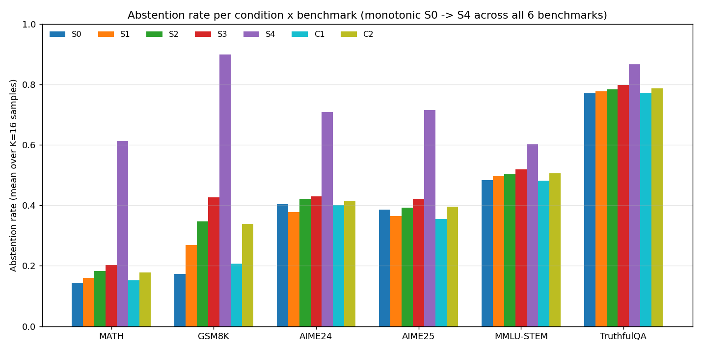
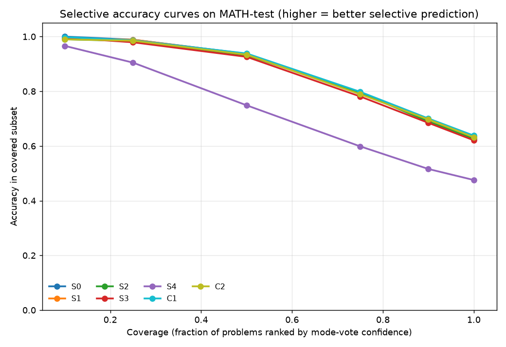

# Under GRPO, asymmetric "don't guess" rewards reduce to a single abstention dial

*Rahul Krishnan. Work done March to June 2026, in collaboration with Sanjana Deshpande. Code: https://github.com/rahulk98/project-fear*

**TL;DR.** We trained Qwen 2.5 1.5B and 3B base models with GRPO under seven reward schemes that punish wrong answers more than they reward right ones, hoping the models would learn to abstain when they are likely to be wrong. The rewards changed how often the models abstained. They did not improve accuracy on the questions the models still answered, and they did not change how well the models' confidence ranked right versus wrong answers. The reason is an elementary property of GRPO's within-group z-score normalization: after z-scoring, every (correct, wrong, abstain) reward triple is equivalent to (1, 0, t) for a single number t. The seven-condition sweep is one dial, not seven designs. A concurrent paper (Che et al. 2026) derives a closely related result formally; our contribution is the empirical side, including explicit abstention rewards, a 3B check, a no-normalization ablation and a cross-task transfer test.

## Why this matters for honesty

A model that answers every question, including the ones it does not know, will hallucinate. One proposed fix is to change the incentives: score a wrong answer worse than an abstention, so that guessing stops paying. Kalai et al. (2025) argue that binary right/wrong grading is a root cause of hallucination for this reason, and several recent RL papers add an abstention option with a wrong-answer penalty (TruthRL, Reinforced Hesitation, Abstain-R1, KARL).

The decision theory is clean. With reward $+\alpha$ for a correct answer, $-\beta$ for a wrong one and $r_a$ for abstaining, an expected-value maximizer should answer only when its probability of being right exceeds

$$\tau = \frac{\beta + r_a}{\alpha + \beta}.$$

So the reward ratio looks like a knob for "answer only when you are at least $\tau$ confident". The hope is that RL then teaches the model to abstain on the specific questions it would get wrong, which is a per-question calibration skill. We found that, under GRPO as usually implemented, the reward cannot teach that skill. It can only move a global threshold.

## Setup

**Training.** Qwen 2.5 1.5B base (main) and Qwen 2.5 3B base. GRPO via TRL 0.15.2 with LoRA, group size $G = 8$, 1500 steps, learning rate $10^{-6}$, KL coefficient 0.04, sampling temperature 0.7. Training problems: MATH train levels 4 and 5 plus the longest quarter of GSM8K train (5883 problems). Answers are graded symbolically with math_verify.

**Abstention.** There is no "I don't know" token. A response with no boxed final answer counts as an abstention and receives $r_a$, so the model has to discover silence as a strategy.

**Conditions.**

| Condition | $\alpha$ (correct) | $\beta$ (wrong) | $r_a$ (abstain) | $\tau$ |
|---|---|---|---|---|
| S0 | 1.0 | 1.0 | 0.0 | 0.50 |
| S1 | 1.0 | 2.0 | 0.0 | 0.67 |
| S2 | 0.5 | 2.0 | 0.0 | 0.80 |
| S3 | 0.1 | 1.0 | 0.0 | 0.91 |
| S4 | 0.0 | 1.0 | 0.0 | 1.00 |
| C1 | 1.0 | 1.0 | 0.2 | 0.60 |
| C2 | 1.0 | 1.0 | 0.5 | 0.75 |

S0 to S4 raise the wrong-answer penalty (implicit abstention). C1 and C2 pay for abstaining (explicit abstention). C2 and S2 reach nearly the same threshold through different mechanisms. A positive-only control P0 uses +1 / 0 / 0.

**Evaluation.** K=16 sampled rollouts per problem (K=32 for some runs) and greedy decoding, on MATH, GSM8K, AIME 2024 and 2025, MMLU-STEM and TruthfulQA-MC. We report abstention rate, accuracy on attempted questions ("accuracy when answering"), and selective-prediction curves.

## The mechanism: z-scoring leaves one degree of freedom

GRPO samples $G$ responses per prompt and uses the within-group z-score as the advantage:

$$A_i = \frac{r_i - \mathrm{mean}(r)}{\mathrm{std}(r)}.$$

This is invariant to any transform $r \mapsto a r + b$ with $a > 0$. Map the wrong-answer reward $-\beta$ to 0 and the correct-answer reward $\alpha$ to 1. The abstain reward then lands at

$$t = \frac{r_a + \beta}{\alpha + \beta},$$

which is exactly the threshold $\tau$. Every condition in the table is therefore the triple (correct = 1, wrong = 0, abstain = t), and GRPO can only tell conditions apart through $t$. Two consequences follow.

1. **Two-outcome groups ignore the reward values.** If a group contains only two distinct outcomes, for example only correct and wrong answers, every condition gives the same advantages. With $k$ of $G$ responses at the higher reward they are $+\sqrt{(G-k)(G-1)/(Gk)}$ and $-\sqrt{k(G-1)/(G(G-k))}$, functions of the counts alone.
2. **Three-outcome groups see only $t$.** When correct, wrong and abstained responses all occur, the design enters only through where abstention sits between wrong and correct.

A worked example: a group of 4 with one correct, two wrong and one abstained response, z-scored with the sample standard deviation as in the trainer.

| Condition | $t$ | correct | wrong | abstain |
|---|---|---|---|---|
| S0 | 0.50 | +1.306 | -0.783 | +0.261 |
| C1 | 0.60 | +1.225 | -0.816 | +0.408 |
| C2 | 0.75 | +1.091 | -0.849 | +0.606 |
| S2 | 0.80 | +1.046 | -0.856 | +0.665 |
| S3 | 0.91 | +0.946 | -0.864 | +0.782 |
| S4 | 1.00 | +0.866 | -0.866 | +0.866 |

By contrast, a group of 8 with two correct and six wrong answers gets advantages +1.620 and -0.540 under all seven conditions.

Raising $t$ raises the abstain advantage in mixed groups, which pushes the model to abstain more. But the reward values carry no information about which question the model is likely to get wrong; any per-question signal has to come from the group composition, and that is the same for every condition. So we should expect the sweep to move a global abstention rate and leave the per-question ranking alone. S4 is a degenerate corner: at $t = 1$, abstaining is worth as much as being right.

None of this is deep. Affine invariance of the z-score is standard, and analyses of binary-reward GRPO use the closed form above. The point is the consequence for reward design: tuning the wrong-answer penalty under GRPO is tuning one scalar.

## Results

All numbers are recomputed from the raw evaluation files (per-run metrics and rollouts). Unless stated otherwise, each condition is one training seed; see Limitations.

### 1. The sweep moves abstention, not accuracy when answering

Greedy decoding on MATH test (5000 problems), 1.5B:

| Condition | $t$ | Attempt rate | Accuracy when answering |
|---|---|---|---|
| S0 | 0.50 | 0.867 | 0.618 |
| S1 | 0.67 | 0.857 | 0.617 |
| S2 | 0.80 | 0.849 | 0.612 |
| S3 | 0.91 | 0.836 | 0.602 |
| S4 | 1.00 | 0.325 | 0.513 |

As $t$ rises the model answers less often, and its remaining answers are no more accurate. If punishment taught the model to drop the questions it would get wrong, accuracy when answering would rise. Instead it falls slightly through S3 and sharply at S4. GSM8K is the same (attempt rate and accuracy when answering: S0 0.951 and 0.722, S3 0.717 and 0.699, S4 0.017 and 0.591).

With K=16 sampling, accuracy when answering on MATH goes from 0.535 (S0) to 0.510 (S3) and 0.410 (S4). This is not only a selection effect: on the 1326 MATH problems that all seven conditions attempt by majority vote, per-attempt accuracy still drops from 0.626 (S0) to 0.493 (S4).

*Figure 1. Abstention rate (mean over K=16 samples) per condition on six benchmarks, Qwen 2.5 1.5B.*

Abstention rises with $t$ on every benchmark, though not strictly everywhere: on AIME 2024 and 2025 (30 problems each), S1 abstains slightly less than S0.

### 2. The confidence ranking does not change

If the rewards improved per-question calibration, the model's own confidence (agreement of the majority answer across K=16 samples) would separate right from wrong answers better. Figure 2 shows the selective-accuracy curves on MATH: S0 to S3, C1 and C2 lie on top of each other. Only S4 is worse.

*Figure 2. Accuracy on the covered subset when MATH test problems are ranked by mode-vote confidence, 1.5B.*

Area under the risk-coverage curve (AURC, lower is better), recomputed from the rollouts with the same ranking:

| Condition | MATH AURC | GSM8K AURC |
|---|---|---|
| P0 (positive-only) | 0.1067 | 0.0409 |
| C1 | 0.1114 | 0.0511 |
| S0 | 0.1125 | 0.0497 |
| S1 | 0.1141 | 0.0530 |
| C2 | 0.1158 | 0.0604 |
| S2 | 0.1165 | 0.0631 |
| base model | 0.1196 | 0.0663 |
| S3 | 0.1219 | 0.0644 |
| S4 | 0.2537 | 0.2859 |

No punishment condition beats the symmetric baseline, and the positive-only control P0 is best. S0 and P0 are identical in two-outcome groups, since {+1, -1} is an affine image of {+1, 0}. They differ only in $t$: 0.5 for S0, 0 for P0, where abstaining is as bad as being wrong.

### 3. Explicit and implicit abstention are interchangeable

C2 pays for abstaining; S2 punishes wrong answers; their thresholds are 0.75 and 0.80. With K=16, C2 and S2 have MATH abstention 0.178 and 0.183 and accuracy when answering 0.518 and 0.519; on GSM8K, 0.339 and 0.347 abstention and 0.653 and 0.652 accuracy when answering. Their AURC values are adjacent. Two different-looking designs give the same policy.

### 4. The 3B check

At 3B we trained S0 and P0 (one seed each, K=32 evaluation), which differ only in $t$. MATH accuracy over all problems is 0.422 for S0 and 0.419 for P0, while S0 abstains more: 0.069 versus 0.032 on MATH, 0.067 versus 0.010 on GSM8K. On MMLU-STEM accuracy (0.185 versus 0.184) and abstention (0.653 versus 0.654) match. Because S0 abstains more at the same MATH accuracy, its MATH accuracy when answering is about 2 points higher (0.453 versus 0.432, derived from the numbers above). With one seed per condition we cannot tell whether that gap is real. On GSM8K, S0 has lower accuracy (0.689 versus 0.729).

### 5. Removing the normalization lets the magnitude through, badly

If z-scoring is what erases the reward values, removing it should bring them back. We trained S0 and S2 with a signed, unnormalized advantage (1.5B, one seed, K=32):

| Benchmark | S0 abstention | S2 abstention |
|---|---|---|
| MATH | 0.152 | 0.461 |
| GSM8K | 0.186 | 0.797 |
| MMLU-STEM | 0.484 | 0.934 |

Now the penalty reaches behavior: S2 abstains three times as often as S0 on MATH. But it moves toward over-abstention, not selective abstention. Subtracting only a global mean gives intermediate values (S0 versus S2: 0.162 versus 0.226 on MATH, 0.280 versus 0.502 on GSM8K). The z-score hides the asymmetry, and it also keeps high-penalty training from sliding into refusal.

### 6. The threshold transfers to another task, competence does not

We used the 1.5B adapters zero-shot as step-correctness judges on PRM800K. Judge abstention rises with $t$: 0.342, 0.367, 0.386, 0.426 and 0.549 for S0 to S4 at temperature 0, with the same order at 0.7. At 1.0 the order breaks (S0 0.717, S1 0.699, S2 0.743, S3 0.718, S4 0.747), with n = 2000. Judging accuracy on attempted items stays flat across S0 to S4 (0.635 to 0.648 at temperature 0). The willingness to abstain carries over; the competence does not change.

### 7. What the probes showed

We trained linear probes on last-token hidden states to predict whether a sampled answer is correct. A probe trained on one condition's rollouts decodes correctness on every other condition almost as well as that condition's own probe: across 14 trained conditions, mean off-diagonal AUROC is 0.989 on MATH and 0.992 on GSM8K, against 0.998 and 1.000 on the diagonal (worst single pair 0.787 on MATH). The conditions appear to share one internal correctness direction and differ mainly in the abstention threshold, as the mechanism predicts.

We also compared probes against self-consistency and across domains. The output files behind those numbers were not preserved, so we leave them out until they are re-run.

## What we can and cannot conclude

**Observed.** Across seven conditions at 1.5B, abstention moved with $t$ while accuracy when answering stayed flat or fell and the confidence ranking did not change. The two matched-threshold conditions behaved alike. At 3B, the two conditions differed in abstention, not MATH accuracy. Without normalization, the reward magnitude mattered, in the over-abstaining direction.

**Inferred.** Under z-scored GRPO with a scalar correct/wrong/abstain reward, the penalty acts as a global abstention bias, not a per-question calibration signal.

**Not shown.** That asymmetric rewards cannot teach calibration with other estimators, reward shapes, larger models or longer training; or whether the 3B accuracy-when-answering gap is real.

## Limitations

- **Scale.** 1.5B and 3B only, trained on one shared A100 40GB. 7B was out of reach.
- **Seeds.** Most runs have one seed. S0, S3 and C2 have a second seed at K=16, and the seeds agree closely on MATH (accuracy 0.459 and 0.458, 0.406 and 0.401, 0.426 and 0.426). All other conditions, the 3B runs and the ablations have one seed and no error bars.
- **3B coverage.** Only S0 and P0 were trained at 3B: two points on the dial, not the sweep.
- **Abstention format.** "No boxed answer" mixes deliberate refusal with failures to finish. Mean completion length falls with $t$ (1519 characters for S0, 1466 for S3, 976 for S4 on MATH), which argues against truncation as the cause.
- **Estimators.** We tested z-score, global-mean and unnormalized advantages, not RLOO, Dr. GRPO or decoupled abstention advantages.

## Related work and what is new

- **Che, Yuan, Zhao and Yu (2026), arXiv 2608.00301**, is the closest work. For the +1 / $-\lambda$ / 0 rule they show that in the sparse-answer regime GRPO's group normalization replaces every designed penalty with an effective penalty of one, moving the learned threshold to 1/2, with experiments at 1.5B and 7B. Their treatment is formal and covers penalty-only rules. Ours was done independently and is empirical, covering explicit abstention rewards, their equivalence with penalties, accuracy when answering and confidence ranking, a normalization ablation and cross-task transfer.
- **Liu et al. (2025), arXiv 2503.20783 (Dr. GRPO)**, show that dividing by the group standard deviation biases updates by question difficulty, and remove it. They do not discuss reward-scale invariance.
- **Zhu et al. (2025), arXiv 2506.01347**, study negative-sample reinforcement; our S3 matches their weighting.
- **Abstention and calibration rewards.** TruthRL (arXiv 2509.25760) uses a ternary reward with z-scored GRPO. Reinforced Hesitation (arXiv 2511.11500) uses +1 / 0 / $-\lambda$ without dividing by the standard deviation. TIAR (arXiv 2605.25850) notes that an abstention reward shifts the group statistics and decouples the abstention advantage. RLCR (arXiv 2507.16806) rewards verbalized confidence with a Brier score.

What we think is new: the reduction stated for full three-level designs (every scheme is (1, 0, t)), and evidence that the full sweep behaves as that one dial, including the C2 and S2 equivalence, the unchanged confidence ranking, the 3B check, the ablation and the transfer to step judging.

## Next steps

1. **Rewards that vary within an outcome class.** Any reward under which two correct answers can score differently escapes the reduction. A verbalized confidence scored with a proper scoring rule (as in RLCR) is one option. A probe score is another: our probes decode correctness well, so a probe-shaped reward would add a per-sample signal that group composition at $G = 8$ cannot.
2. **Estimators that keep magnitude without collapsing.** RLOO or a mean-only baseline keep the reward scale, but our ablation suggests they need a guard against over-abstention, such as a decoupled abstention advantage (TIAR) or Che et al.'s report-level repair.
3. **Measure per-question calibration directly.** Report "when the model abstains, was it likely to be wrong?" next to the abstention rate. This split is coded and will be run on the cached rollouts.
4. **More seeds and error bars** for the main 1.5B conditions, and the no-normalization ablation at 3B.

## Acknowledgements

Sanjana Deshpande collaborated on the project.
